# BSCCM · Predicting white blood cell markers from label-free images

Can a microscope image tell us how much of a protein a white blood cell carries, even in a fresh blood sample?
We train an image encoder to predict fluorescence-derived marker levels and use it as a teacher for a second model that reads stained blood smears.
Our primary score, **GOAL**, averages prediction–measurement correlations for 11 targets when we train on one blood draw and test on the other.
Through N090 (24 November 2026), the target is **.700**. The official record is **.6967** (N085, a pre-registered equal-weight ensemble of eight members), which cleared the improvement threshold of **.6916** (previous record .6862 + 2 x noise). Caveat: six of the eight members were chosen after their scores on these same two draws were known (together they scored .6929); the two new ConvNeXt-S members add +.0038, below 2 x noise. Only a third, untouched blood draw could test how much of the gain generalises, and BSCCM has two. The previous record was **.6862** (N053, three members; Cytoland was selected among four candidates on the evaluation draws).
Bright markers associated with cell type transfer well. For dim markers such as CD19 and CD56, changing the fluorescence background estimate changes the target values.
Across three ImageStream donors, training on one marker per cell weakened predicted CD4–CD8 exclusivity. The differences between training regimes were statistically inconclusive.
On MLL23, a reused clinical development benchmark, distilling LF features gave the Giemsa student a higher mean class-ranking AUROC than distilling marker outputs. The AUROC gain of .113 passed the registered .074 effect-size rule, but the paired test across three teachers gave p = .07. [GOAL register](.agent-research/notebook/GOAL.md) · [Overview figures](figures/overview/CAPTIONS.md)

**Reading guide** · [Data and terminology](#what-one-training-example-contains) · [Data and checkpoints](#data-and-checkpoints) · [Evaluation](#what-counts-as-progress) · [Results by task](#what-worked-for-each-task) · [Reproduction](#reproduce-the-marker-ensembles) · [Repository and cluster](#repository-and-cluster) · [Experiment history](#experiment-history) · [Figures](#figure-gallery) · [Current work](#current-work-and-open-questions)

## What one training example contains

**BSCCM** stands for Berkeley Single Cell Computational Microscopy. It contains **412,941 human white blood cells**.
An LED array illuminates each cell in several ways while a camera records the same crop.
Brightfield shows transmitted light. Darkfield emphasizes light scattered by the cell.
Directional illumination reveals changes in optical phase, which carry information about the cell's internal structure.
Stacking 23 illumination patterns and one computed phase image gives one **24 × 128 × 128** label-free input (LF).
The six fluorescence channels are recorded separately. They supply supervision. [Dataset audit][N001] · [Channel definitions](bsccm/data.py)

A **surface marker** is a protein on a cell that an antibody can bind. A fluorescent dye attached to the antibody produces a signal that estimates how much of the marker is present.
The targets in this project are transformed fluorescence intensities. A high correlation means that predictions track variation in those measurements.
White blood cell families, or *lineages*, differ in both appearance and protein expression. A model that recognizes lymphocytes, granulocytes and monocytes can therefore predict some variation in a marker without distinguishing two cells of the same type. [Study design][N004] · [Cell-type control][N006]

| Which cells? | What the microscope measured on the same cell | What this lets us learn |
|---|---|---|
| Single-antibody slide | LF stack, fluorescence for one named protein, autofluorescence estimate | Train that marker head. The other single-marker entries are missing. |
| Pooled or “all” slide | LF stack and fluorescence from a mixture of antibodies, separated into dye groups | Train pooled heads. Antibodies sharing a dye contribute one combined reading. |
| Unstained cells | LF stack and intrinsic fluorescence, also called autofluorescence | Estimate background and learn an auxiliary readout. |
| Wright/Giemsa subset of unstained cells | LF stack, autofluorescence and a registered colour photo after staining | Match an image across modalities and test a student's autofluorescence prediction on the same cell. |

For orientation, CD3, CD19 and CD56 help identify different lymphocyte populations (T, B and natural killer cells). **Co-expression** asks which markers occur together on an individual cell. A stain such as Wright makes features like the nucleus and granules visible in colour. That morphology can suggest a cell family even when it cannot distinguish two cells with different marker profiles. [Marker and morphology study](.agent-research/results/N002-literature-review-trimodal-alignment-wit/SYNTHESIS.md) · [Measured marker pairs][N080]

There are **two blood draws**, each divided among slides for different antibody conditions. “Batch” in the data means an isolation, distinct from an optimizer minibatch.
A **field of view** (FOV) is one camera field on a slide and can contain several cells.
Cells from the same field share illumination, background and sample preparation. Cells on the same slide also share a stain and acquisition session.
The release provides draw identity without individual donor IDs. New-draw performance is consequently a two-direction transfer experiment. [Pairing and splits][N004] · [Slide audit][N003]

A single-stain cell typically has one observed protein plus autofluorescence. After quality control, pooled cells have four observed group targets in draw 0 and three in draw 1, with no autofluorescence target.
The 37,284 pooled-panel cells report groups such as CD3/CD19/CD56, a dye shared by three antibodies.
The combined intensity cannot distinguish a CD3-bright cell from a CD19-bright cell with the same total signal.
**Gates** (cell-type assignments derived from measured signals) are available exclusively on draw-0 pooled slides. Of the 10,210 cells there, 10,161 have a gate and 10,137 have a single gate.
No BSCCM cell has two separately measured *single-stain* markers. An output vector with a prediction in every column is easy to produce. Its within-cell pattern is much harder to validate. [Dataset design][N004] · [Joint-decoding review][N079]

The **15,712 Wright/Giemsa photos** (GS in code) correspond to 10,015 LF cells from draw 0 and 5,697 from draw 1.
Every one comes from an antibody-unstained slide. There are **zero same-cell GS–surface-marker pairs**.
LF bridges the datasets. We can teach a Giemsa network to imitate the LF teacher on paired images, then test it against measured autofluorescence.
A marker estimate reached by this route depends on assumptions about what the LF image captured.
In particular, a marker and the Giemsa image might share information even after conditioning on LF. The project cannot test that assumption from the two sets of pairs alone. [Premise audit][N004] · [Simulation][N016] · [Error estimates][N017]

### Why bring in other datasets?

| Dataset | Available observations | Role in the experiments |
|---|---|---|
| PBC | 17,092 clinical peripheral blood smear images with expert cell-class labels | Adapt the GS reader with common cell classes on half A. Test marker rankings on disjoint half B, including classes withheld from adaptation. |
| MLL23 | Clinical smear images with class labels, including finer blood-cell populations | External comparison of predicted marker rankings. No MLL23 cells enter training or alignment. Repeated use to compare methods makes it a development benchmark. |
| S-BIAD452 | ImageStream imaging flow cytometry, 274,050 cells, three donors. Two brightfield images and side scatter as input, nine antibody measurements per cell | Hide different subsets of a known marker vector during training. Compare full and sparse supervision on a held-out donor where all nine true values are available. |

PBC and MLL23 test an *ordering*. For example, how often does a neutrophil receive a higher CD16 prediction than an eosinophil?
The images and class labels support this test even when individual marker concentrations are unavailable.
ImageStream supports a different question. The nine markers are CD15, Siglec8, CD14, CD19, CD3, CD45, CD4, CD56 and CD8. Their target levels are derived from background-subtracted fluorescence images on all donors. Five of its markers overlap with BSCCM (CD3, CD14, CD19, CD45 and CD56), and all nine are measured together, allowing a direct test of correlations between markers. [PBC audit][N008] · [MLL23 contrasts][N022] · [External data audit][N077] · [Donor protocol][N080]

## Data and checkpoints

The raw BSCCM data are distributed through Dryad. The Git repository excludes cell images, packed arrays and training checkpoints. N001 describes how to verify and pack the data, and the cluster inventory below gives the expected filenames. The private GitHub release uses the `bsccm-data-model` branch of `Jetzu/BSCCM`. [Packing record][N001] · [Cluster files](#cluster-files) · [GitHub release](https://github.com/Jetzu/BSCCM/tree/bsccm-data-model)

The private Hugging Face repository `Jetzu77/BSCCM` holds weights-only checkpoints. Fine-tuned models include configurations and held-out predictions. SSL folders contain the encoder and projector weights. Resuming training with optimizer state requires a cluster checkpoint. [Hugging Face release](https://huggingface.co/Jetzu77/BSCCM) · [Release record][N089]

| Folder | Contents |
|---|---|
| `ensemble_N053/` | `resnet50_full_view`, `resnet50_zoom2` and `cytoland_convnextv2_tiny`, each for both draw directions |
| `ensemble_N084/` | `convnext_s_member` for each direction. Combine it with the three N053 members. |
| `control/` | `resnet50_ssl_v10` for both directions |
| `composite_N063/` | `panel_seed2`, `panel_seed3`, `twopart_fovre_seed2` and `twopart_fovre_seed3` |
| `ssl_encoders/` | `resnet50_ssl_trained_on_draw0`, `resnet50_ssl_trained_on_draw1`, `convnext_s_ssl60_trained_on_draw1` and `convnext_s_ssl120_trained_on_draw0` |

## What counts as progress

1. **Choose a direction.** `b10` means train on draw 1 and test on draw 0. `b01` reverses them. The GOAL fine-tunes use eligible source-draw rows and score split 2 (held-out FOVs) of the other draw. GS rows are excluded. A separate `fov` experiment trains on split 0 and tests on split 2 across both draws. It answers an easier question. [Split implementation](scripts/train_lf.py)
2. **Exclude the test draw from self-supervised learning (SSL).** SSL learns from unlabelled images before marker fine-tuning. Each direction gets its own encoder initialization. Historical LF flat-field calibration uses unlabelled slide statistics, including test slides. Model training and instrument calibration therefore have different data boundaries. [Inductive control][N031] · [Calibration audit][N053]
3. **Score each target on observed cells.** Compute Pearson's correlation coefficient, *r*, between predictions and measurements using the target's mask. Average the 11 correlations with equal weight, then average the two directions with equal weight. For an ensemble, align cell rows and average member predictions **before** calculating correlations. [Common-11 scorer](scripts/score_goal_arms.py) · [Ensemble scorer](.agent-research/results/N053-lf-encoder-swap-on-the-v10-goal-dinov3-v/n053_score.py)
4. **Track the three pooled targets separately.** **MM3** averages the three pooled-target correlations over both directions. A cell-type-only predictor reached .730 on pooled targets in the reviewed b01 test. MM3 can improve while biologically important marker pairs remain unresolved within a type. [MM3 replication][N083] · [Cell-type baseline][N079]
5. **Freeze the question before looking at the result.** The experiment record specifies the primary comparison, label file, baseline and success threshold. The estimated GOAL seed standard deviation is **.0027**. “Improved” requires a gain **greater than twice that noise**, currently a score **above .6916**. A positive difference below the bar is *flat*. A secondary combination can guide the next experiment. [Rules](.agent-research/notebook/RULES.md) · [Noise and threshold](.agent-research/notebook/GOAL.md)

The **common 11** are eight single proteins (CD16, CD14, CD45, CD3, CD123, CD56, HLA-DR and CD19)
and three pooled targets (`grp:CD3/CD19/CD56`, `grp:CD45`, `grp:CD16`).
The regression head has 13 outputs. Autofluorescence is auxiliary. A fourth pooled target, `grp:CD123/HLA-DR/CD14`, failed quality control on one draw.
Those last two outputs carry no GOAL weight. A blank target has no training loss. [Target definitions](scripts/make_targets_v5.py) · [Figure 6 caption](figures/overview/CAPTIONS.md)

### The labels changed during the project

| Era | Why the yardstick changed | Control that keeps the comparison honest |
|---|---|---|
| v3 → v4 | Slide position alone predicted raw autofluorescence and CD19 at median r ≈ .840. Fit a position trend to each fluorescence target and subtract it. The encoder still sees the actual LF image. | The FOV versus new-draw gap narrowed from about .220 to .080. On detrended v4 the supervised baseline scored .5545 over 12 marker targets. |
| v4 → v5, N023 | A pooled group on draw 1 was dimmer than crosstalk on a single-stain control slide. Mask it and standardize multi-slide targets per slide. | The **same N014 predictions** moved from .5742 (12 targets, v4) to .6287 (11, v4) to .6343 (11, v5). Training on v5 reached .6404 versus .6346 for the seed-matched control. |
| v5 → v10, N051 | The old per-slide intensity scale amplified noise among dim cells. Choose an inverse-hyperbolic-sine (`asinh`) cofactor per marker by a pre-specified label-only rule. Use clean calibration and a position trend cross-fitted by FOV. | The **same N031 ensemble** scored .6527 on v5 and .6703 on v10. On that same v10 yardstick, the N048 cofactor-150 ensemble reached .6804 and the v10-trained pair .6788. |

A cofactor sets the intensity scale at which `asinh` switches from near-linear to logarithmic compression.
V10 uses 150 for CD16/CD45 and 500 for the other six singles. Changing this transform changes which differences between cells matter to Pearson correlation.
Only a comparison on common evaluation labels can establish a model gain. The current target file is `targets_v5cx_v10.npz`. [Spatial control][N012] · [v4][N013] · [v5][N023] · [v10 reassessment][N051]

Two other scores recur below. **R@10** is the fraction of queries whose exact paired cell is among the ten closest candidates.
**AUROC** is the probability that a randomly sampled cell from the expected high-marker class ranks above one from the expected low-marker class, with half credit for ties.
Chance AUROC is .500. A clinical class contrast, cross-slide retrieval and marker-level correlation measure different things. [Retrieval design][N045] · [Clinical protocol][N056]

## What worked for each task

Three learning methods recur across the comparisons. In **distillation**, a student learns to reproduce a teacher’s outputs or internal representation. **Optimal transport** matches two distributions under a cost for moving one observation toward another. **Conditional flow matching** learns how to transform noise into samples compatible with a given image. Only the first requires a teacher, and matching a distribution alone does not identify an individual cell. [GS student][N010] · [Transport experiment][N045] · [Flow experiment][N034]

| Task | Best-supported result | What fell short |
|---|---|---|
| LF → markers | Diverse views and encoders. N053 scored .6862 after screening four candidate third members. Adding ConvNeXt-S in N084 gave .6911 and MM3 .7764. | Full-rate Cytoland alone scored .646. The DINOv3 and DinoBloom transfer recipes scored .649–.655. Learning rate, resolution and pooling also varied. [Encoder comparison][N053] · [Confirmation][N084] |
| Joint decoding | On BSCCM, ConvNeXt-S raised single-network MM3 from .758 to .771 over two seeds. On ImageStream, complete labels gave mean r .596 versus .526 with one marker or .542 with simulated pools. | Within-type r stayed .150–.200. Within T cells, measured CD4–CD8 correlation was −.810, predicted −.360 with full labels, −.070 with one and +.160 with pools. None of the regime differences was significant across three donors. Single-marker training had the lowest mean error over four within-population pairs (.308 versus .389 for full labels). [Sandbox][N080] · [MM3][N083] |
| LF ↔ Giemsa | Directly distilling LF outputs into a GS student gave held-out-slide autofluorescence r .658, latent distillation .650. | SigLIP R@10 averaged .030 across held-out slides, the more reliable retrieval test. Within-slide R@10 of .38–.40 reflects genuine cell identity: a control trained on different cells from the same field reaches only .02–.03 (N092). Adding unpaired cells with optimal transport (SOTAlign) gave .028. The distillation teacher also saw unstained cells of the held-out slide, so this compares complete pipelines. [Alignment][N045] · [Latents][N054] |
| Giemsa → clinical | Match the LF latent and anchor the learner with PBC class labels. At matched anchor strength the MLL23 15-contrast mean was .681 versus .568 with output distillation. The gain .113 exceeded the registered .074 seed floor, with teacher-paired p = .07. | Strengthening the output student's anchor alone gave .604 and .627. Unconditional adaptation on PBC varied by contrast. Strong performance on classes used as anchors is partly circular. [Anchors][N021] · [Matched teachers][N058] |
| Generative images | LF → virtual Wright retained strong lineage readouts. For fluorescence generation, residual flow on a frozen regressor scored per-cell r .594 versus regression at .599 in N034’s development direction. | Plain flow improved distributional scores but gave .476 versus .576 per cell in the frozen reverse-direction test. Residual flow still had higher new-draw continuous ranked probability score (CRPS) than plain flow (.591 vs .569, lower is better). It failed its registered rule and has no frozen reverse-direction confirmation. [Virtual stain][N028] · [Flow confirmation][N035] · [Residual flow][N044] |
| Unpaired alignment | Hiding individual pairings within bags of the **same cells** retained r .548 and .503 for sizes 4 and 16, versus .561 with pairs, in a one-direction linear-readout experiment whose frozen encoder saw unlabelled images of both draws. | For bags of different cells, the signed mean r was near zero. Systematic field effects gave mean absolute r of .05–.15 and individual marker correlations of either sign with magnitudes up to .48. Unpaired Gromov–Wasserstein alignment as the last step of the two-space model gave GS autofluorescence r .322. Clinical OT aligned distributions without a consistent ranking gain. [Sets][N034] · [Two spaces][N054] · [Clinical OT][N056] |
| Draw shift | The N084 directions scored .7030 (1 → 0) and .6793 (0 → 1). At matched optimization steps, doubling labelled cells gave +.016 on the N082 screen. | Re-estimating batch-normalization statistics cost .005–.011. On the held-out cells, v10 and local-background CD19 labels correlated at .24 and .40 in the two directions (mean .32). Disagreement identifies a measurement problem without identifying the correct background. [Adaptation][N026] · [Gap review][N066] · [Learning curve][N082] |

Averaging the two directions for N084 alone gives CD16 .900. The weakest singles are CD19 .360, HLA-DR .480, CD56 .531 and CD123 .596. Compare a cell with its neighbours in one field and a shared background offset cancels. Compare cells *across* fields and the same offset changes the target differences the model must explain. This is why the within-FOV control can improve while the images and predictions stay fixed. [Per-target data](figures/overview/data/per_target.csv) · [Figure 3](figures/overview/fig3_gap.png) · [Within-FOV control][N038]

The clearest example of the difference between population accuracy and per-cell decoding comes from ImageStream.
Giving each cell the **mean profile of its true gated type** reached .814, above all three image models.
This oracle uses information unavailable at inference, and the T-cell gates themselves use CD4/CD8.
Correctly recognizing a high-CD4 population therefore explains much of the overall score, while the failure to reproduce CD4/CD8 exclusivity shows what averaging across types can hide. [Nine-marker controls][N080] · [Figure 4](figures/overview/fig4_multimarker.png)

## Reproduce the marker ensembles

### Architecture and training recipe

| Member | What it sees | Initialization and fine-tuning |
|---|---|---|
| N048 full view | ResNet-50, 128 × 128, 2,048 pooled features | In-domain SSL, then marker supervision on cofactor-150 labels. |
| N048 centre zoom | A second ResNet-50, central 64 × 64 resampled to 128 × 128 | Same direction-specific SSL checkpoint, separate fine-tune on cofactor-150 labels. |
| N053 Cytoland | ConvNeXtV2-T, 768 features, learned gain per channel | Published VSCyto2D microscopy encoder. Adapt its one-channel stem to 24 inputs and use 0.1× encoder learning rate. Fine-tune on v10. |
| N084 addition | ConvNeXt-S, 768 features, full view | In-domain SSL for 60 epochs on draw 1 or 120 on draw 0, followed by a v10 fine-tune with seed 1. |

The full-view ResNet has 23.6M parameters, Cytoland 27.9M and ConvNeXt-S 49.5M.
For in-domain SSL, draw two augmented views of an unlabelled source cell, encourage their projections to agree, and regularize the projected distribution toward a Gaussian with SIGReg to avoid collapse.
The ResNets use 40 SSL epochs. At fine-tuning, pool the encoder features and fit 13 linear outputs with masked mean squared error.
Auxiliary 3- and 10-class heads use cross-entropy with classification weight 0.5 on eligible gated cells. Inference uses the regression outputs.
Train for 10 epochs with AdamW and a one-cycle learning-rate schedule peaking at 0.0005, batch size 256 and random shifts up to four pixels.
Rotating a crop would change which physical illumination direction a channel describes, so the record recipe uses translations.
[Architecture caption](figures/overview/CAPTIONS.md) · [Teacher code](scripts/train_lf.py) · [View construction](bsccm/ssl.py)

### Start with the saved predictions

On the project cluster the packed data, weights and saved predictions already have the paths expected by the scripts.
Run the following Bash commands from the repository root. They write scores into a fresh temporary directory.
Use any Python 3 environment with NumPy and pandas on the CPU. The training commands use Apptainer.

```bash
# From the repository root, score the archived predictions in a subshell.
(
set -eu
repo=$PWD
W=/hnvme/workspace/v181bb10-bsccm
out=$(mktemp -d)
require_predictions() {
  if [[ ! -s "$1" ]]; then
    printf 'Missing predictions: %s\n' "$1" >&2
    return 1
  fi
}

# Check all positions in the two directions before calculating a mean.
for member in n048_v9_base n048_v9_zoom2 n053_cytoland n053_cytoland_s1 n051_v10_base; do
  for d in b10 b01; do
    require_predictions "$W/runs/${member}_${d}/eval_preds.npz"
  done
done
for member in n083_cnxs60_s1_b10 n084_cnxs120_s1_b01; do
  require_predictions "$W/runs/$member/eval_preds.npz"
done

# Single models. Each arm names a run prefix without its _b10 or _b01 suffix.
python3 scripts/score_goal_arms.py "$out" \
  control=n048_v9_base zoom=n048_v9_zoom2 cytoland=n053_cytoland

# N053 averages saved predictions row by row, then scores the common 11.
python3 .agent-research/results/N053-*/n053_score.py "$out/n053.csv" \
  n048_v9_base+n048_v9_zoom2+n053_cytoland \
  n048_v9_base+n048_v9_zoom2+n053_cytoland_s1

# N084 uses different ConvNeXt-S run names for the two directions.
# Its scorer writes n084_scores.csv in the current directory.
(cd "$out" && python3 "$repo"/.agent-research/results/N084-*/n084_score.py)
printf 'Scores: %s\n' "$out"
)
```

`eval_preds.npz` contains a prediction matrix `P` and global cell-row IDs `G`.
The N053 scorer verifies the same row order across members. Every scorer above reads **v10** measurements for those IDs.
In `score_goal_arms.py`, comma-separated runs are replicate **seeds**. It writes `goal_arms.csv` (target-level), `goal_summary.csv` and `plot_goal.csv`.
Use the N053 scorer's **plus-separated** syntax for an ensemble. The fine-tuner's generic validation mean can include a different set of columns. [Arm scorer](scripts/score_goal_arms.py) · [N053 scorer](.agent-research/results/N053-lf-encoder-swap-on-the-v10-goal-dinov3-v/n053_score.py) · [N084 scorer](.agent-research/results/N084-pre-registered-ensemble-confirmation-n05/n084_score.py)

| Expected check on saved predictions | Draw 1 → 0 | Draw 0 → 1 | GOAL | MM3 |
|---|---:|---:|---:|---:|
| N053, three members | .7001 | .6723 | .6862 | .7734 |
| N053, retrain only Cytoland with seed 1 | .7043 | .6685 | .6864 | — |
| N084, add ConvNeXt-S to seed-0 N053 | .7030 | .6793 | .6911 | .7764 |
| N085, eight-member union E8 (current record) | .7066 | .6869 | .6967 | .7856 |

These numbers can be reproduced from the archived predictions without retraining. Both ResNets were trained on cofactor-150 labels and scored on v10 labels.
Replacing the cofactor-150 ResNets with the v10-trained controls changes the ensemble. [N048 jobs](.agent-research/results/N048-label-v9-asinh-cofactor-from-a-pre-regis/jobs.txt) · [N053 seed replication](.agent-research/results/N053-lf-encoder-swap-on-the-v10-goal-dinov3-v/n053_followup.csv) · [N084 score table](.agent-research/results/N084-pre-registered-ensemble-confirmation-n05/n084_scores.csv)

### Rebuild the members on the cluster

**1. Prepare the inputs.** The necessary files are listed in [Repository and cluster](#repository-and-cluster).
For a rebuild from raw data, N001 records fetching and verifying the Dryad chunks, making the indexed zip and packing the arrays.
N005 adds the LF flat fields, slide scales and target masks. N029 excludes Giemsa cells from calibration and N036 cross-fits the spatial detrend.
The N048 and N051 build scripts call the versioned target builders with the cofactor and cross-fit settings needed for the final label files.
The Cytoland adapter expects the converted VSCyto2D weights at the path in `bsccm/cytoland.py`.
[N001 packing][N001] · [LF calibration][N005] · [cf150 build](.agent-research/results/N048-label-v9-asinh-cofactor-from-a-pre-regis/n048_build.sh) · [v10 build](.agent-research/results/N051-label-v10-per-marker-asinh-cofactor-pre/n051_build2.sh) · [Cytoland loader](bsccm/cytoland.py)

**2. Locate or recreate the source-draw SSL checkpoints.** N031's `jobs.txt` records the job IDs only. These are equivalent trainer invocations reconstructed from its item and the trainer defaults. Their settings agree with the archived offline run configurations.
Run the following Bash blocks in order from the repository root in the same GPU allocation. Each direction needs the completed `encoder_final.pt` from its own source draw. The two directions can use separate GPUs. The commands below run each trainer directly with Apptainer on an allocated GPU.

On the original cluster, `scripts/gpu_job.sbatch` submits one trainer per SLURM job. It hard-codes the checkout at `$HOME/BSCCM` and the cluster log directory, and calls `~/.claude/skills/work-log/bin/preempt-run.sh`, a helper outside this repository. The plain `apptainer exec` command below runs with the built image and the packed workspace mounted at the paths expected by the trainers. [N031 recipe][N031] · [SSL trainer](scripts/train_ssl_lf.py) · [GPU wrapper](scripts/gpu_job.sbatch)

```bash
W=/hnvme/workspace/v181bb10-bsccm
# Create a NEW directory under runs/ for this rebuild and keep its name for every step.
build=$(mktemp -d "$W/runs/rebuild_XXXXXXXX")
printf 'Rebuild directory: %s\n' "$build"
ssl_root=$build
gpu() {
  [[ -d "${build:?Set up the rebuild directory first}" ]] || return 1
  WANDB_MODE=offline apptainer exec --nv --bind "$W" "$W/env/bsccm.sif" python3 -I "$@"
}

# Each SSL checkpoint goes in a NEW subdirectory of "$build".
for heldout in 0 1; do
  gpu scripts/train_ssl_lf.py --arm aug --out "$build/n031_ssl_aug_ex$heldout" --arch resnet50 --epochs 40 --bs 512 --views 2 --lr 0.002 --lam 0.05 --proj-dim 256 --rows all --exclude-batch "$heldout" --seed 0
done
```

To reuse the archived ResNet SSL checkpoints, run the setup through the `gpu` function, skip the SSL loop and set `ssl_root="$W/runs"`. All fine-tunes still write under `$build`.

**3. Fine-tune the two ResNets and Cytoland for N053.** These commands use the archived training settings and write to the new rebuild directory.
The N048 run name contains `v9`. These four commands build the full and zoomed models actually used in the record.
Jobs 1376834 and 1376835 build its third member. There is no ensemble-training job. [N048 jobs](.agent-research/results/N048-label-v9-asinh-cofactor-from-a-pre-regis/jobs.txt) · [N053 jobs](.agent-research/results/N053-lf-encoder-swap-on-the-v10-goal-dinov3-v/jobs.txt)

```bash
# Write each fine-tune to a NEW subdirectory under "$build" from step 2.
gpu scripts/train_lf.py --out "$build/n048_v9_base_b10" --protocol b1to0 --channels all --phase 1 --arch resnet50 --epochs 10 --bs 256 --lr 0.0005 --workers 15 --seed 0 --w-cls 0.5 --include-gs 0 --dual-zoom 1 --targets targets_v5cx_cf150.npz --zoom 1 --init-ssl "$ssl_root/n031_ssl_aug_ex0/encoder_final.pt"
gpu scripts/train_lf.py --out "$build/n048_v9_zoom2_b10" --protocol b1to0 --channels all --phase 1 --arch resnet50 --epochs 10 --bs 256 --lr 0.0005 --workers 15 --seed 0 --w-cls 0.5 --include-gs 0 --dual-zoom 1 --targets targets_v5cx_cf150.npz --zoom 2 --init-ssl "$ssl_root/n031_ssl_aug_ex0/encoder_final.pt"
gpu scripts/train_lf.py --out "$build/n048_v9_base_b01" --protocol b0to1 --channels all --phase 1 --arch resnet50 --epochs 10 --bs 256 --lr 0.0005 --workers 15 --seed 0 --w-cls 0.5 --include-gs 0 --dual-zoom 1 --targets targets_v5cx_cf150.npz --zoom 1 --init-ssl "$ssl_root/n031_ssl_aug_ex1/encoder_final.pt"
gpu scripts/train_lf.py --out "$build/n048_v9_zoom2_b01" --protocol b0to1 --channels all --phase 1 --arch resnet50 --epochs 10 --bs 256 --lr 0.0005 --workers 15 --seed 0 --w-cls 0.5 --include-gs 0 --dual-zoom 1 --targets targets_v5cx_cf150.npz --zoom 2 --init-ssl "$ssl_root/n031_ssl_aug_ex1/encoder_final.pt"
gpu scripts/train_lf.py --out "$build/n053_cytoland_b10" --protocol b1to0 --channels all --phase 1 --arch cytoland --epochs 10 --bs 256 --lr 0.0005 --enc-lr-mult 0.1 --workers 15 --seed 0 --w-cls 0.5 --include-gs 0 --targets targets_v5cx_v10.npz
gpu scripts/train_lf.py --out "$build/n053_cytoland_b01" --protocol b0to1 --channels all --phase 1 --arch cytoland --epochs 10 --bs 256 --lr 0.0005 --enc-lr-mult 0.1 --workers 15 --seed 0 --w-cls 0.5 --include-gs 0 --targets targets_v5cx_v10.npz
```

For the fresh Cytoland seed at .6864, keep both ResNets and replace the Cytoland prediction in each direction with the following seed-1 run.
The seed-0 training predates a small normalization-epsilon correction in the Cytoland loader. The saved predictions preserve the original record exactly. [N053 replication notes][N053]

```bash
# Write each fine-tune to a NEW subdirectory under "$build" from step 2.
gpu scripts/train_lf.py --out "$build/n053_cytoland_s1_b10" --protocol b1to0 --channels all --phase 1 --arch cytoland --epochs 10 --bs 256 --lr 0.0005 --enc-lr-mult 0.1 --workers 15 --seed 1 --w-cls 0.5 --include-gs 0 --targets targets_v5cx_v10.npz
gpu scripts/train_lf.py --out "$build/n053_cytoland_s1_b01" --protocol b0to1 --channels all --phase 1 --arch cytoland --epochs 10 --bs 256 --lr 0.0005 --enc-lr-mult 0.1 --workers 15 --seed 1 --w-cls 0.5 --include-gs 0 --targets targets_v5cx_v10.npz
```

**4. Add ConvNeXt-S for the N084 comparison.** First train the two SSL encoders. After each checkpoint is complete, run the fine-tune for the same source draw.
The longer SSL run is on draw 0, the smaller training draw. The archive calls the two fine-tunes `n083_cnxs60_s1_b10` and `n084_cnxs120_s1_b01`. Here both share the prefix `n084_convnext_s` so that the ensemble scorer can find them by direction. The historical N084 scorer also reads the saved N051 v10 full-view baseline for its control row. [N078 jobs](.agent-research/results/N078-in-domain-ssl-scaling-sigreg-lf-pretrain/jobs.txt) · [N083 jobs](.agent-research/results/N083-convnext-s-in-domain-ssl-encoder-for-mul/jobs.txt) · [N084 jobs](.agent-research/results/N084-pre-registered-ensemble-confirmation-n05/jobs.txt) · [N051 control jobs](.agent-research/results/N051-label-v10-per-marker-asinh-cofactor-pre/jobs.txt)

```bash
# Write SSL and fine-tune runs to NEW subdirectories under the same rebuild root.
# Pretrain, draw 1 then draw 0 (two independent jobs).
gpu scripts/train_ssl_lf.py --arm aug --out "$build/n078_ssl_cnxs_60_ex0" --arch convnext_small --epochs 60 --bs 512 --views 2 --lr 0.002 --lam 0.05 --proj-dim 256 --rows all --exclude-batch 0 --seed 0
gpu scripts/train_ssl_lf.py --arm aug --out "$build/n083_ssl_cnxs_120_ex1" --arch convnext_small --epochs 120 --bs 512 --views 2 --lr 0.002 --lam 0.05 --proj-dim 256 --rows all --exclude-batch 1 --seed 0

# Fine-tune after the corresponding encoder_final.pt is available
gpu scripts/train_lf.py --out "$build/n084_convnext_s_b10" --protocol b1to0 --channels all --phase 1 --epochs 10 --bs 256 --lr 0.0005 --workers 15 --w-cls 0.5 --include-gs 0 --targets targets_v5cx_v10.npz --arch convnext_small --init-ssl "$build/n078_ssl_cnxs_60_ex0/encoder_final.pt" --seed 1
gpu scripts/train_lf.py --out "$build/n084_convnext_s_b01" --protocol b0to1 --channels all --phase 1 --epochs 10 --bs 256 --lr 0.0005 --workers 15 --w-cls 0.5 --include-gs 0 --targets targets_v5cx_v10.npz --arch convnext_small --init-ssl "$build/n083_ssl_cnxs_120_ex1/encoder_final.pt" --seed 1
```

**5. Score the rebuild.** Once both directions of each model finish, use the run paths relative to `runs/`. The N053 scorer accepts the four-member combination and checks cell-row alignment in each direction. The historical N084 scorer in the archive example uses fixed run names. [Ensemble scorer](.agent-research/results/N053-lf-encoder-swap-on-the-v10-goal-dinov3-v/n053_score.py) · [N084 scorer](.agent-research/results/N084-pre-registered-ensemble-confirmation-n05/n084_score.py)

```bash
# Read only the NEW training outputs and write scores into a NEW directory.
(
set -eu
family=${build##*/}
scores=$(mktemp -d "${build:?Use the rebuild directory from step 2}/scores_XXXXXXXX")
pair="$family/n048_v9_base+$family/n048_v9_zoom2"
trio="$pair+$family/n053_cytoland"
python3 scripts/score_goal_arms.py "$scores" control="$family/n048_v9_base" \
  zoom="$family/n048_v9_zoom2" cytoland="$family/n053_cytoland"
python3 .agent-research/results/N053-*/n053_score.py "$scores/ensembles.csv" \
  "$trio" "$pair+$family/n053_cytoland_s1" "$trio+$family/n084_convnext_s"
printf 'Rebuild scores: %s\n' "$scores"
)
```

For model changes, register the primary comparison before examining candidate ensemble scores. [Experiment rules](.agent-research/notebook/RULES.md)

## Repository and cluster

The Git repository holds code, notebook records, compact results and figures. The raw cells, packed arrays, model weights and checkpoints live **outside Git** in the cluster workspace.
Start with the notebook item for an experiment. It records its hypothesis, comparator and evidence. Its result directory holds the job ledger, scorer, CSVs and review artifacts where available.

| Repository path | Contents |
|---|---|
| [bsccm/](bsccm/) | Shared data access, encoders, output heads, normalization and augmentation. |
| [scripts/](scripts/) | Data preparation, training and evaluation entry points. The SLURM wrappers live alongside them. |
| [env/bsccm.def](env/bsccm.def) | Apptainer recipe using `/hnvme/workspace/v181bb10-salad/torch29_cu128.sif` from another project’s workspace. Building elsewhere requires supplying a compatible local Torch/CUDA base and updating `From`. The recipe pins Torch 2.9.1 and torchvision 0.24.1. |
| [tests/](tests/) | CPU checks of SSL view construction, loss behavior, illumination-aware augmentation and its trainer integration. |
| [figures/overview/](figures/overview/) | Numbered PNG and SVG figures, JSON sidecars, source tables, panel captions and figure builders. |
| [.agent-research/notebook/](.agent-research/notebook/) | Current [index](.agent-research/notebook/INDEX.md), [archive](.agent-research/notebook/INDEX_ARCHIVE.md), dated [item records](.agent-research/notebook/items/), [GOAL](.agent-research/notebook/GOAL.md) and [rules](.agent-research/notebook/RULES.md). |
| [.agent-research/notebook/KNOWLEDGE.md](.agent-research/notebook/KNOWLEDGE.md) | Findings by K-number, including refutations and caveats. [IDEAS](.agent-research/notebook/IDEAS.md) and [TODO](.agent-research/notebook/TODO.md) track proposals and unfinished controls. |
| [.agent-research/results/](.agent-research/results/) | One directory per documented item, named `N###-slug`. Also holds experiment-specific analysis scripts that never became general entry points. |
| [.agent-research/plots/](.agent-research/plots/) | Comparison plots indexed by metric and date. Local SLURM stdout and stderr use `logs/`. |

### Cluster files

All paths below are relative to `/hnvme/workspace/v181bb10-bsccm/`. Array row is the global cell ID unless an explicit map is given. [Pack specification][N001] · [Data loader](bsccm/data.py) · [External packer](scripts/pack_sbiad452.py)

| Path below the workspace | Purpose |
|---|---|
| `BSCCM.zarr.zip`, `bsccm_zip_index.npz`, `bsccm_zip_index_zarrmeta.json` | Original release repacked into one seekable archive and its chunk-offset index. |
| `pack/led_array.npy`, `pack/dpc.npy` | Memory-mapped LF input stack and phase reconstruction. |
| `pack/fluor.npy` | Six-channel fluorescence crops used to construct or study the supervision. |
| `pack/histology.npy`, `pack/hist_cells.npy` | 398 × 398 RGB Wright crops and their mapping to LF cells. |
| `bsccm_index.parquet`, `bsccm_sm.parquet`, `cellmeta.npz` | Cell, slide, acquisition and released surface-marker records. |
| `backgrounds_p50.npy`, `led_norm.npz` | Flat fields, slide scales and channel normalization statistics. |
| `targets_v3.npz` | Global row, draw and split metadata used to select the unlabelled SSL cohort. |
| `targets_v5cx_cf150.npz`, `targets_v5cx_v10.npz` | N048 training labels and common v10 evaluation labels. Each contains target values, observation masks and split metadata. |
| `external/pbc/`, `external/mll23/` | Packed clinical smear datasets. |
| `external/sbiad452/`, `external/sbiad452_pack/` | ImageStream source stores and local packed training arrays. |
| `models/`, `emb/`, `runs/` | External pretrained weights, saved embeddings and named run directories containing checkpoints and evaluation predictions. |
| `env/bsccm.sif`, `wandb/`, `agent-research-large/` | Built container, offline metrics and large research artifacts. |

### Main entry points

Read the script docstrings for input filenames and historical variants. Later target versions reuse the v3–v5 builders with calibration options controlled by item-specific build scripts.

| Script in `scripts/` | Use |
|---|---|
| [fetch.py](scripts/fetch.py) | Download the Dryad release in resumable, checksum-verified chunks. |
| [convert.py](scripts/convert.py) | Stream the release into a single Zarr-readable zip. |
| [build_index.py](scripts/build_index.py) | Index compressed chunk offsets for parallel reads. |
| [pack.py](scripts/pack.py) | Decode chunks into fixed-record, memory-mappable arrays. |
| [verify_pack.py](scripts/verify_pack.py) | Independently decode sampled original records and check packed rows. |
| [audit.py](scripts/audit.py) | Tabulate dataset coverage, antibody conditions and gates. |
| [audit_match.py](scripts/audit_match.py) | Check LF–Wright pairing by crop morphology against shuffled pairs. |
| [extract_backgrounds.py](scripts/extract_backgrounds.py) | Extract per-illumination flat fields. |
| [led_norm_stats.py](scripts/led_norm_stats.py) | Fit slide and channel normalization statistics. |
| [make_targets.py](scripts/make_targets.py) | Make the initial values, masks, gate labels, FOV splits and histology row map. |
| [make_targets_v2.py](scripts/make_targets_v2.py) | Calibrate pooled targets against unstained controls within each draw. |
| [make_targets_v3.py](scripts/make_targets_v3.py) | Fit calibration on split-0 rows and support later cofactor choices. |
| [make_targets_v4.py](scripts/make_targets_v4.py) | Remove position trends from fluorescence targets, with a cross-fitted option. |
| [make_targets_v5.py](scripts/make_targets_v5.py) | Mask the failed draw-1 pooled target and standardize multi-slide targets. |
| [make_targets_v6.py](scripts/make_targets_v6.py) | Keep the autofluorescence target on unstained slides only. |
| [make_targets_tt6c.py](scripts/make_targets_tt6c.py) | Assemble clean marker and autofluorescence labels for the two-teacher chain. |
| [label_qc.py](scripts/label_qc.py) | Check label behavior against cell classes independent of the fluorescence readout. |
| [dye_spectra.py](scripts/dye_spectra.py) | Estimate dye signals and crosstalk from single-stain controls. |
| [train_ssl_lf.py](scripts/train_ssl_lf.py) | Pretrain a label-free encoder with augmentation-only or cross-illumination views. |
| [probe_lf.py](scripts/probe_lf.py) | Fit readouts to frozen encoder features under matched splits. |
| [train_lf.py](scripts/train_lf.py) | Fine-tune the LF marker regressor, evaluate, and export row-indexed predictions or features. |
| [rescore_targets.py](scripts/rescore_targets.py) | Rescore fixed predictions after changing target definitions. |
| [score_goal_arms.py](scripts/score_goal_arms.py) | Score individual runs and paired seed comparisons on v10 common-11. |
| [pack_sbiad452.py](scripts/pack_sbiad452.py) | Pack the external ImageStream images and nine-marker data. |
| [train_ifc_sandbox.py](scripts/train_ifc_sandbox.py) | Train and test joint decoding under full, single and pooled supervision on held-out donors. |
| [pack_fluor_aux.py](scripts/pack_fluor_aux.py) | Construct dense fluorescence targets for the training-only auxiliary decoder. |
| [embed_giemsa.py](scripts/embed_giemsa.py) | Extract frozen DinoBloom features from registered Wright crops. |
| [embed_external.py](scripts/embed_external.py) | Extract scale-matched PBC and BSCCM smear features. |
| [train_bind.py](scripts/train_bind.py) | Bind frozen Giemsa and marker features to the LF pivot. |
| [train_gs_bind.py](scripts/train_gs_bind.py) | Train the image-level Giemsa student against an LF teacher. |
| [apply_gs_student.py](scripts/apply_gs_student.py) | Apply a trained student and evaluate clinical class contrasts. |
| [aggregate_transfer.py](scripts/aggregate_transfer.py) | Aggregate clinical contrast results over seeds and arms. |
| [gs_mk_estimates.py](scripts/gs_mk_estimates.py) | Estimate transitive marker correlations and compare the assumption with measured autofluorescence. |
| [sim_mosaic.py](scripts/sim_mosaic.py) | Hide pairs between LF channel subsets to test the error estimates with known truth. |
| [vs_register.py](scripts/vs_register.py) | Register LF and Wright crops for image translation. |
| [vs_train.py](scripts/vs_train.py) | Train the paired LF-to-virtual-Wright generator. |
| [vs_eval.py](scripts/vs_eval.py) | Evaluate held-out virtual stains and export the generated crops. |
| [vs_downstream.py](scripts/vs_downstream.py) | Compare a student's readouts on real and virtual stains of the same cells. |
| [vs_generate.py](scripts/vs_generate.py) | Render virtual stains for marker-labelled cells. |
| [fm_prep.py](scripts/fm_prep.py) | Prepare fluorescence-image targets, backgrounds and scale factors. |
| [fm_common.py](scripts/fm_common.py) | Define shared conditioning, target transforms, network and sampler components. |
| [fm_train.py](scripts/fm_train.py) | Train conditional fluorescence-image flow or matched regression models. |
| [fm_eval.py](scripts/fm_eval.py) | Score generated distributions and per-cell readouts in-draw and across draws. |
| [fm_figure.py](scripts/fm_figure.py) | Plot matched brightfield, fluorescence, samples and readout comparisons. |
| [n034_setmatch_sim.py](scripts/n034_setmatch_sim.py) | Hide cell pairings to test what bag-level supervision can recover. |

In `bsccm/`, [data.py](bsccm/data.py) defines the channel order and CPU normalization, and [gpu_norm.py](bsccm/gpu_norm.py) applies the same transform to batches.
[ssl.py](bsccm/ssl.py) implements the views and SSL loss. [encoders.py](bsccm/encoders.py) and [cytoland.py](bsccm/cytoland.py) adapt pretrained weights to LF.
[heads.py](bsccm/heads.py) implements the experimental readouts, [phys_aug.py](bsccm/phys_aug.py) models acquisition perturbations, and [dense_aux.py](bsccm/dense_aux.py) implements training-only fluorescence supervision.

### Running jobs

The cluster uses SLURM. The generic CPU wrapper requests a 48-core NUMA fraction on `preempt_cpu`. Packing parallelizes over cell blocks.
The training wrapper requests one GPU and 16 host cores on `preempt`, binds the workspace into the container, and invokes Python with the contents of `CMD`.
Jobs can be preempted. The training wrapper resumes from checkpoints using the cluster-only work-log helper outside Git. The direct Apptainer invocation in rebuild step 2 works without that helper.
A restarted job can receive a new SLURM ID, so check that the final encoder file exists before using it in a dependent run. [CPU wrapper](scripts/cpu_job.sbatch) · [Packing job](scripts/pack.sbatch) · [GPU wrapper](scripts/gpu_job.sbatch) · [N078 resubmissions](.agent-research/results/N078-in-domain-ssl-scaling-sigreg-lf-pretrain/jobs.txt)

The project uses GPUs when the task is at least twice as fast as a well-parallelized CPU run. Estimate the total GPU-hours before submitting a training sweep. A sweep above 25 GPU-hours needs project approval.
Record each training submission in its experiment item, including config, job ID, budget and log path, and register its offline Weights & Biases run and sync lineage.
Compute nodes have no internet. The login-node cron syncs offline metrics. Completed runs also leave local results and predictions. [Release record][N089] · [Sync script](scripts/wandb_sync_cron.sh)

For a lightweight code check in an environment with the project dependencies, run the CPU unit tests from the root with `python -m unittest discover -s tests`.
In the round-one code check, 16 of 19 discovered tests passed. Three augmentation integration tests raised a name error because their isolated fixtures lack newer trainer globals (`DEVICE`, `_run_args` and `DENSE`). The saved-prediction commands above ran successfully and reproduced both GOAL ensembles. [SSL tests](tests/test_ssl.py) · [Acquisition augmentation tests](tests/test_phys_aug.py)

## Experiment history

The links lead to experiment records or their rows in the notebook index. Early scores use the label version and split in force at the time. Scores are rounded to three decimals except where extra precision identifies a record, re-base or small effect.
“Flat” refers to an item's registered comparison. A positive result for the GS student or MM3 can coexist with a flat GOAL result.
As of 24 November 2026, the N088 literature review is complete, N085 set the record (.6967), N087 (decoders, autoencoders, marker priors) and N090 (gentle fine-tuning, worse) are complete, and N089 records the private release.
The index jumps from N068 to N073. [Archive](.agent-research/notebook/INDEX_ARCHIVE.md) · [Current index](.agent-research/notebook/INDEX.md)

### Establish the dataset and the two measurable links

**[N001] · Pack and verify the release.** Converted the 50 checksum-verified Dryad chunks into indexed memory-mapped arrays for 412,941 cells.
Independent decoding found zero mismatched arrays in the sampled records. The pack became the common input format.

**[N002] · Literature review, learning through a shared modality.** Reviewed six strands of work on partial pairings, transfer and evaluation.
The review proposed hiding known pairs in a simulation to test transitive error estimates. The two real paired datasets alone could not establish GS marker accuracy. [Review synthesis](.agent-research/results/N002-literature-review-trimodal-alignment-wit/SYNTHESIS.md)

**[N003] · Audit the LF–GS matches.** Areas measured independently from matched Wright and LF phase images had Spearman correlation .740 versus .000 after shuffling.
Pairing was informative but imperfect. The outlier analysis gave a rough upper estimate around 7% for mismatches and heavy-tailed residuals together.

**[N004] · Change the project design after auditing the pairing.** All 15,712 GS cells belonged to antibody-unstained slides.
With zero GS–marker pairs, use LF as the bridge and distinguish measured same-cell endpoints from inferred marker agreement.

**[N005] · Build masked targets and calibrate the images.** Constructed 13 outputs with masks, draw-specific controls and gated cell classes.
Flat-field correction reduced brightfield background–radius correlation from −.435 to −.040. Preserve illumination direction during augmentation.

### First LF models and the spatial confound

**[N006] · Supervised ResNet-18 baseline.** On v3, mean r over 12 marker targets was .707 on held-out FOVs and .494/.471 across draws.
A three-class mean predictor matched or beat the network on several gated pooled targets. Cell type explained much of the initial signal.

**[N007] · Self-supervised pretraining.** Tested two views of a cell with disjoint illumination channels against augmentation-only views.
Frozen augmentation-only probes reached .486/.472 across draws versus .460/.435 for disjoint illumination. The registered verdict was **worse**. Even the augmentation-only probe fell below the supervised ResNet-18 across draws (.479 vs .483) and on held-out FOVs (.522 vs .707). Cross-illumination views weakened both scores.

**[N008] · Test an external cell-type anchor.** A PBC classifier with .988 in-domain accuracy called 72–75% of the BSCCM Wright cells platelets.
In-domain GS clusters agreed with LF-predicted broad classes on .858 of cells. The PBC classifier did not transfer directly.

**[N009] · Bind frozen GS and marker encoders to LF.** The first fused model ranked the paired LF cell in the top ten for .011 of queries against all 5,697 cells on the held-out slide (chance R@10 ≈ .0018).
Linear contrastive alignment reached .033 across slides. Its .349 within-slide score was later shown not to be a field-of-view shortcut (N092). Early raw-autofluorescence comparisons were revisited after N012.

**[N010] · Train the Giemsa image encoder.** Fine-tuning the last four DinoBloom blocks with stain augmentation, normalization or adversarial training yielded raw-autofluorescence r .284–.308 on the first held-out slide.
On later detrended targets the student reached .648/.323 across slides versus its LF teacher's .559/.305.

**[N011] · Diagnose slide shift.** A classifier identified the slide with .920 accuracy from GS features and .990 from LF features.
Direct GS regression on raw autofluorescence fell from about .620 within slide to .440–.450 across slides, prompting a spatial control.

**[N012] · Test position alone.** A region-blocked position model predicted raw autofluorescence and CD19 with median r .840 each.
It also predicted CD56 (.530) and CD123 (.490). Spatial backgrounds confounded several apparent biological signals.

**[N013] · Detrend the labels, v4.** Removed each slide's position trend from the targets and flagged 567 suspect image pairs.
ResNet-18 reached .555 across draws on the 12-target metric. The FOV-to-draw gap shrank from about .220 to .080.

**[N014] · Fine-tune the SSL encoder as a marker teacher.** On v4 the pretrained ResNet-50 reached .574 versus .565 for ResNet-50 trained from scratch.
Adversarial draw invariance gave .554 for the ResNet-18 arm. Fine-tuning recovered value that the frozen probes missed.

**[N015] · Pass the improved teacher to the GS student.** The student distilled from the stronger LF marker model scored .641/.303 on detrended autofluorescence across the two slides.
Improving the LF marker task gave no corresponding improvement on the GS autofluorescence endpoint.

**[N016] · Test the bridge where ground truth is available.** Split LF illumination channels into two artificial modalities and hid the direct pairs.
Error bounds covered 95% of comparisons. Distilled r .457–.488 was close to the direct oracle .465 in this same-instrument simulation.

**[N017] · Estimate GS marker error on real cells.** Combined student–teacher correlation and teacher–measurement correlation under a calibrated-teacher and conditional-independence assumption.
For draw 0 → 1 this estimated CD16 at .800 and CD123 at .170. The measured GS autofluorescence check was .649. Only the latter has same-cell truth.

**[N018] · Map information to illumination patterns.** On held-out FOVs, brightfield alone gave .585 across 12 targets, all darkfield .619 and the full stack .635.
CD123 specifically gave .384 from darkfield versus .390 from the full stack. The map was evaluated within draws.

### Transfer the GS student and repair the labels

**[N019] · Test the GS student on clinical PBC smears.** Zero-shot marker rankings varied widely. CD16 for neutrophils versus eosinophils gave AUROC .107, while the CD14 monocyte contrast gave .709.
The direct transfer failed several pre-specified biological orderings.

**[N020] · Adapt using unlabelled PBC images.** Adapted on half A and tested on half B. Mean AUROC was .406 unadapted, .438 after whitening and .462/.555 with the two adversarial weights.
Individual contrasts could reverse. Distribution matching gave no consistent clinical gain. [PBC contrast values](.agent-research/results/N020-clinical-transfer-via-unsupervised-domai/pbc_transfer_auroc.csv) · [Reviewed comparison](figures/overview/fig9_alignment_domain.png)

**[N021] · Add common-class anchors.** Trained against labelled PBC neutrophils, lymphocytes and monocytes. Anchor-related comparisons scored .790–1.000 but partly reused the fitted class structure.
For the unanchored eosinophil CD16 contrast, AUROC was .950 and .360 on two seeds. Finer transfer remained unstable.

**[N022] · Give rare cells more training weight.** Tail weighting and a focal-loss gate head raised in-draw FOV r from .654 to .674.
MLL23 fine-contrast AUROC was .494 for the tail-weighted chain versus .630 for the earlier ResNet-18 reference. The in-draw gain failed to transfer.

**[N023] · Repair a pooled assay and re-base on v5.** Draw-1 pooled CD123/HLA-DR/CD14 failed dye and cell-type controls. Dropping it and changing normalization took frozen predictions from .574 to .6343.
Training on repaired labels then gave .640 against a matched .6346. Only the latter comparison measures training progress.

**[N024] · Trace the v5 labels through the GS chain.** Within-slide GS autofluorescence rose from .383/.689 to .510/.867.
MLL23 fine-contrast AUROC fell from .622 to .536. The same-cell proxy and external clinical ranking favored different teachers.

**[N025] · Use separate teachers for different readouts.** TT6 used a v4 marker teacher and a v6 autofluorescence teacher trained with unstained-slide autofluorescence.
The registered GOAL result was **flat**, .639 for the v6-trained SSL ResNet-50 versus .6404 on v5. GS autofluorescence was .578/.855 and MLL23 AUROC .611 versus the v4 chain's .622. Clinical non-inferiority remained unresolved, and review identified a target-calibration leak.

**[N026] · Model the cell at two scales.** Averaging a full-view and 2× zoomed ResNet reached .651/.652 on v5 using SSL that included unlabelled images of both draws.
A same-scale full-view ensemble gave .6438. Re-estimating batch-normalization statistics on the test draw reduced r by .005–.011.

**[N027] · Increase Giemsa-student capacity.** More trainable blocks and more steps reduced MLL23 fine-contrast AUROC from .611 to .529 with DinoBloom-B and .420 with DinoBloom-L.
Additional capacity failed to improve same-cell truth or clinical transfer.

**[N028] · Generate virtual Wright images from LF.** Trained on registered LF–GS pairs. Structural image similarity on the two held-out slides was .872/.865.
In the within-draw FOV test, a student reading real and generated crops agreed at roughly .900–.950 on strong lineage markers, but only about .500 on CD123/CD19. The result establishes cell-specific appearance with limited fine detail.

**[N029] · Remove GS cells from all label-calibration fits.** Rebuilt the clean two-teacher chain (TT6c). Its within-slide GS autofluorescence was .564/.848 against .395/.654 for the single teacher.
The gain survived the leakage control. Retraining also changed MLL23 performance, motivating a teacher-seed study.

**[N030] · Freeze more of the GS encoder.** MLL23 fine-contrast AUROC was .482 with all blocks frozen, .589 with two trainable and .611 with four.
Together with N027, the experiment favored the existing four-block student.

**[N031] · Enforce source-only SSL.** Retrained an SSL encoder for each direction, excluding the entire held-out draw.
The v5 full-plus-zoom ensemble scored .6527 versus .651 with both draws in SSL. The inductive version became the comparison standard.

**[N032] · Vary the LF teacher across training runs.** Four teacher runs yielded MLL23 fine-contrast means from .477 to .611.
Immature-granulocyte/myelocyte CD16 and hairy-cell HLA-DR transferred more reliably than eosinophil CD16. Subsequent clinical comparisons paired or averaged teachers.

**[N033] · Use virtual stains as labelled training data.** Generated Wright-like images for 317,935 marker-labelled cells and supplied their measured markers to the GS student.
MLL23 AUROC moved from .551 to .565, inside teacher-run variability. Extra synthetic images gave no established transfer gain.

### Generate fluorescence images and investigate the v5 plateau

**[N034] · Learn a fluorescence-image distribution and hide cell pairs.** Conditional flow matching samples possible images given LF. On the development direction it improved CRPS (a probabilistic error score, .570 vs .780 for regression) but reduced mean per-cell r to about .550 from .610.
In a separate scalar experiment with hidden pairings, bags of 16 of the same cells retained .503 versus paired .561. For different-cell bags, positive and negative correlations cancelled in the signed mean. Field effects produced mean absolute r of .05–.15 and individual magnitudes up to .48.

**[N035] · Freeze the sampler and reverse the draw direction.** With 48 Heun steps and guidance 2, flow improved CRPS (.674 vs .815) and conditional Wasserstein distance (.692 vs .727), both lower-is-better metrics.
Per-cell r fell to .476 versus regression's .576. Better distributional predictions did not yield more accurate values for an individual cell.

**[N036] · Cross-fit the position correction.** Fit each spatial trend on other FOV folds and retain it only if it improves held-out variance.
The split-dependent FOV variance-share gap shrank from .055 to .017. N037 tested whether this preprocessing repair improved prediction.

**[N037] · Retrain on cross-fitted labels.** Fine-tuned the two inductive ResNets on v5cx and scored on frozen v5.
The resulting .654 versus .6527 was flat relative to seed noise.

**[N038] · Review 1, locate the v5 plateau.** Centering within FOVs raised the same N031 predictions from .6527 to .7211.
FOV-level background in the dim dye channel explained part of the gap. The review commissioned alternative labels, a label-count curve and input diagnostics.

**[N039] · Change the fluorescence background estimator.** Per-cell subtraction removed much of the FOV structure, but v8 failed the pre-registered label QC, including the draw-1 CD19 positive-mode check.
A v5 single model seeing both draws scored .678 on the GOAL cells, or .659 under data matching. V8 was set aside.

**[N040] · Complete missing labels with a noisy student.** Combining teacher predictions for missing entries with physics augmentation (probability .7) raised single-model r from .6425 to .6529. Augmentation alone gave +.0025, leaving about +.008 of the gain attributable to pseudo-labels.
The v5 student ensemble gave .656 versus .6527, a +.0037 gain below the registered bar despite wins in 16 of 22 target–direction pairs.

**[N041] · Randomize acquisition nuisances.** Varied LED gains, offsets, shot noise and blur with a consistency loss.
The single base model gained .0025, and the ensemble gained .0004 on v5. The augmentation gave no GOAL improvement.

**[N042] · Test whether high-frequency details limit the weak markers.** Blurring with a 1.5-pixel scale changed their correlations by at most .011.
Overall r was .641 versus .643 unblurred. The planned architecture with separate optical stems stopped at this screening test.

**[N043] · Produce the first paper figure set.** Six figures documented architecture, cross-draw markers, label limits, GS transfer, fluorescence generation and set matching.
This was a writing deliverable. The later N086 overview uses a separate figure sequence.

**[N044] · Generate residual fluorescence around a regressor.** The flow learned deviations from a predicted image mean. On N034’s development direction, per-cell r was .550 for plain flow, .594 for residual flow and .599 for regression.
CRPS was .591 versus plain flow's .569. Residual flow met the per-cell criterion but failed the pre-registered rule on calibration. The result lacks a frozen reverse-direction confirmation.

**[N045] · Add semi-supervised optimal transport to paired alignment.** SOTAlign used unpaired LF and clinical smear cells in addition to the GS–LF pairs.
Across slides, mean R@10 was .028 versus .030 for paired SigLIP. Autofluorescence transfer was about .330 versus .660 for output distillation. The added alignment gave no advantage.

**[N046] · Repeat noisy-student training.** Replaced the original teacher with the N040 student ensemble and repeated label completion.
Round two scored .655 versus .656 in round one. The earlier gain did not compound.

**[N047] · Review 2, examine how dim labels are scaled.** The per-slide lower-tail intensity used in the original `asinh` transform magnified background noise.
A fixed cofactor of 50 would score the *same* N031 predictions around .683. This diagnostic justified testing new label definitions with frozen controls.

**[N048] · Build cofactor-based v9 labels.** A negative-control rule selected a cofactor of 150 for the candidate training labels.
The new ensemble scored .652 on frozen v5 and .685 on v9 versus N031's .676 on v9. It later supplied the two ResNets in N053.

**[N049] · Model false positives and missed labelling explicitly.** A two-component mixture could not identify the two error rates separately. Soft targets collapsed to zero for some rare positives.
The approach stopped before training. N051 found that a fit suggesting loss of CD123 positives was a local optimum, with tail contrast actually increasing from 49.5 to 68.7 at cofactor 150.

**[N050] · Try a different CNN family as an ensemble member.** A ConvNeXt-T trained with pseudo-labels still had residual correlations of .940–.960 with the ResNets.
The v5 ensemble scored .6533. Changing backbone did little for the shared errors.

### Re-base on v10, compare encoders and align the three modalities

**[N051] · Select a cofactor for each marker and adopt v10.** The frozen N031 ensemble moved from .6527 to .6703 on the new labels.
Scored on v10, N048 reached .6804 versus .679 for the pair trained directly on v10. The project adopted the new yardstick and subsequently set the .700 target.

**[N052] · Register the three-modality comparison.** Proposed two paired latent spaces (LF–marker and LF–GS) joined by flow, alongside a single LF hub and an output-distilled baseline.
The decision commissioned encoder tests and marker-completion tests. It produced a design, without a new performance estimate.

**[N053] · Compare pretrained encoders and combine complementary members.** The best standalone Cytoland seed scored .667 versus the v10 ResNet control's .6730. The single-encoder criterion failed.
The team chose Cytoland post hoc from four candidate third members evaluated on the test draws. Adding it to the N048 full/zoom pair set the official .6862 record. Retraining the selected member with a fresh seed gave .6864 on the same draws. That checks seed sensitivity but leaves the original model-selection effect unresolved.

**[N054] · Test the two-space model against distillation.** Cross-slide autofluorescence r was .658 for output distillation, .650 for the LF hub and .642/.625 for the two flow paths.
The unpaired final alignment gave .322. Paired latent designs carried signal, while conditional marker completion showed little transferable gain across draws.

**[N055] · Add more Cytoland variants.** The planned four-member combination used a second Cytoland scale and scored .6902.
The comparison stayed below .6916. Later variants explored label and view diversity without establishing a new record.

**[N056] · Compare anchored students and unpaired clinical adaptation.** Hub versus output distillation gave MLL23 AUROC .704 versus .568.
This comparison had unequal anchor gradient shares and missed its registered seed-range rule. Unbalanced transport, mean shift and covariance matching gave no consistent improvement.

**[N057] · Vary the class-anchor strength alone.** Raising its weight from 0.5 to 2 and 8 gave the output student MLL23 means of .568, .604 and .627.
The trend stayed within the specified seed floor. N057 and the matched-strength N058 comparison ran in parallel as follow-ups to N056.

**[N058] · Confirm the hub under matched anchoring.** Across three LF teachers, mean MLL23 AUROC over 12 fine plus three lineage contrasts was .681 for latent distillation and .568 for output distillation.
The gain .113 exceeded the pre-specified .074 seed floor. The paired teacher test gave p = .07.

**[N059] · Review 3, separate model diversity from draw-specific readout.** The .6862 ensemble equalled an in-distribution single-model reference, while within-FOV scoring reached .726.
A few-shot readout reached .704 using labelled new-draw cells, a different protocol. The review led to head and loss experiments. Subsequent controls found no identifiable numeric ceiling.

### Output heads, label errors and training-time supervision

**[N060] · Model rare positives in the output distribution.** The two-part gate-and-amplitude head reached .676 versus the two-seed .671 control.
The histogram-based HL-Gauss head scored .6591. The two-part head helped CD123, but missed the .6784 single-model bar.

**[N061] · Learn from differences within a FOV.** Pair losses (.674) and a model with per-FOV offsets (.674) outscored the .671 control slightly.
Removing the autofluorescence target gave .6713. Each individual change was flat by the registered comparison.

**[N062] · Decode the single stains and pools from shared factors.** An assay-aware panel head scored .670 overall.
The three pooled targets gained about .015–.031 at a cost to singles. This trade-off suggested using different heads for the two assay types.

**[N063] · Combine the specialized heads on fresh seeds.** Take pooled outputs from the panel model and singles from the two-part model with FOV offsets. The two-part network alone scored .677 (.6766 before rounding).
The composite scored .6784 versus fresh controls .668, passing its primary comparison. Adding it to N053 gave .690, below the ensemble bar.

**[N064] · Estimate which parts of the fluorescence measurement are reliable.** Splitting pixels into checkerboard halves gave a reliability-derived r limit of .9999.
Changing the background model gave much lower agreement, particularly on CD19. The pixel check cannot establish a ceiling for predicting the complete label.

**[N065] · Rebuild the ensemble with composite heads.** The pre-specified three-composite ensemble scored .690 versus the .6916 bar.
The planned six-way *descriptive secondary* reached .6929. Only the primary comparison could advance the record.

**[N066] · Review 4, locate the directional gap.** For the frozen six-way model, draw 1 → 0 scored .704 and 0 → 1 scored .6822.
On two pooled-panel slides of the latter test draw, `grp:CD45` scored .881 and .578. Background estimators disagreed systematically by FOV, with no independent reference to decide which one was correct.

**[N067] · Train on the average of two background estimators.** The consensus-label model scored .662 against frozen v10 versus the .671 control.
CD56 fell from .504 to .444. Training on the consensus worsened the primary readout.

**[N068] · Reflect images together with the illumination channels.** Applied an anti-diagonal reflection, swapped corresponding directional LEDs and dropped the unpaired LED119.
The symmetry arm scored .669 and dropping LED119 alone gave .6718. The planned use of the exact optical symmetry was flat.

**N069 · Record unavailable.** The indexes and item directory contain no N069 experiment, score or verdict.

**N070 · Record unavailable.** The indexes and item directory contain no N070 experiment, score or verdict.

**N071 · Record unavailable.** The indexes and item directory contain no N071 experiment, score or verdict.

**N072 · Record unavailable.** The indexed history resumes at N073. No separate experiment or result is documented for N072. [Index](.agent-research/notebook/INDEX.md)

**[N073] · Treat clipped intensities as upper bounds.** Trained with a censored-label loss and a longer, 20-epoch schedule.
The model scored .666, down .0048 against the control. The combined recipe was flat by the project rule.

**[N074] · Predict the fluorescence image during training.** A training-only decoder received supervision from the six-channel fluorescence crop, while the LF marker head kept its original task.
The image decoder learned, but GOAL was .668 versus .671 for the control. Dense supervision failed to improve the scalar predictions.

**[N075] · Keep alternative label definitions in separate heads.** Trained a v10 head and a local-background head on the same encoder, then evaluated the v10 output.
GOAL was .671 versus .6706. Separating the targets avoided the large consensus-label loss without a detectable gain.

### Joint decoding, external donors and the current runs

**[N076] · End training on pooled-panel cells only.** Continued trained networks at low learning rate on the source draw's “all” slides.
MM3 changed by −.0012 and GOAL by −.0025. Concentrating the final updates on pooled cells was flat.

**[N077] · Scout external datasets for joint-marker supervision.** Identified S-BIAD452, with nine markers measured on every cell and five overlapping BSCCM singles.
The scout led to an external donor-held-out benchmark and a shared-trunk transfer test.

**[N078] · Scale in-domain SSL.** Extending ResNet-50 pretraining to 160 epochs gave .6707. A ConvNeXt-S pretrained for 60 epochs gave .669 in the initial GOAL screen.
ConvNeXt-S improved the secondary MM3 score to .774 versus .756 for its matched ResNet seed. N083 tested replication.

**[N079] · Review 5, ask what the pooled-panel metric can establish.** On the reviewed b01 cells, a type-only predictor gave .730 versus .737 for composed single outputs and .746 for the pooled head.
That small gap exposed the limits of MM3 as evidence for within-type co-expression. The review also identified the training-step confound in the earlier label-count curve.

**[N080] · Measure joint decoding with complete truth.** Cycled train/validation/test through three ImageStream donors. Mean r was .596 with all nine labels, .526 with one random label and .542 when 10% of cells contributed pooled labels.
The within-type full-minus-single gap was .020. Whole-donor 36-pair correlation error was .189/.229/.237. Full supervision came closest to measured CD4–CD8 exclusivity within T cells. Single-marker training had the smallest error averaged over all four within-population pairs (.308 versus .389 for full supervision). None of the regime differences reached significance across three donors.

**[N081] · Train on BSCCM and ImageStream together.** Joined dataset-specific image stems to a shared trunk and overlapping marker heads.
BSCCM GOAL fell from .673 to .6673. A shared name for a marker did not make its readout interchangeable between instruments.

**[N082] · Hold optimization steps fixed in a label-count experiment.** Half the labels at 10 and 20 epochs gave .646 and .658. Full labels at 10 epochs gave .673.
At matched steps the label gain was .016, versus .012 from additional updates on the half set. Label quantity dominated this one-seed comparison.

**[N083] · Replicate the ConvNeXt-S pooled-panel gain.** The two matched MM3 gains were .0172 and .0098. Their mean gain of .0135 cleared the registered .007 threshold.
Longer SSL on the smaller draw improved its GOAL direction. Selecting 60/120 epochs by direction gave .675 for one model and .6907 when added to N053, both secondary results.

**[N084] · Confirm the fourth member.** The registered comparison added seed-1 ConvNeXt-S to the three N053 members.
GOAL was .6911, missing .6916 by .0005, with MM3 .7764. The fourth member helped reproducibly but did not advance the official GOAL record.

**[N085] · Record: combine stronger encoders and specialized heads.** Registered a union of eight equal-weight members, including 120-epoch ConvNeXt-S and composite heads, with success defined as GOAL above .6916. The eight-member average scored **.6967** (b10 .7066, b01 .6869, MM3 .7856); every leave-one-out subset stayed above .6916 (.6954-.6976). An independent recomputation confirmed the number, row alignment and source-only training. Caveat: the six older members were selected with knowledge of their test-draw scores (six-member subset .6929); the two new ConvNeXt-S members add +.0038.
The primary comparison cleared the bar: GOAL .6967 (see the record caveat in the summary).

**[N086] · Publish the overview figures.** Five initial figures summarized progress, experiments, errors, joint decoding and GS transfer.
The extension added four architecture and alignment figures. The nine reviewed figures and their data sources are linked below.

**[N087] · Test decoders and autoencoders (complete).** On frozen fine-tuned features no decoder beats the model's own linear head (.673; ridge .670, kNN .664, MLP .661), and the predictions need about 8-12 dimensions (rank 4 .617, rank 8 .656). Frozen self-supervised features (MLP .603) carry no more marker information than 144 hand-made image statistics (.607); a 64-d image autoencoder reaches .624; fine-tuning is worth +.05-.07. Autoencoders cluster held-out cells by cell type better than the self-supervised features (kNN balanced accuracy .34-.35 vs .31) but no better than image statistics (.35), so they mostly encode brightness and scatter. Learned marker priors from another donor's joint labels did not meet their pre-registered bar in the ImageStream sandbox (best: autoencoder prior, co-expression error .212 vs .229 single, bar .21), and a flow-matching decoder fixed the spread but not co-expression. With the same number of labels, all-marker training on 1/9 of the cells gave co-expression error .174 vs .229, so joint measurement, not label count, carries the co-expression. [N087] · [Figure 10](figures/overview/fig10_decoders_autoencoders.png)

**[N097] · Lineage separation of decoded markers (user 11-27).** On BSCCM the record ensemble detects each lineage on its own slide (AUROC CD3 .99/.86, CD14 .98/.97, CD16 .97/.97, CD19 .83/.87) and separates true B from true T cells with predicted CD19 − CD3 at .95 (train draw 1 → 0) but only .70 the other way (10 B cells; about 10% of T cells look B-like). Predicted CD3 and CD19 are anticorrelated within lymphocytes (−.54) but positively correlated over all white cells (+.2), as both are lymphocyte markers. In the ImageStream sandbox, where both are measured on every cell, the predictions are more anticorrelated than the truth (−.84..−.93 vs −.63..−.88) because the model places lymphocytes on one T↔B axis; T-vs-B AUROC still ranges .46–.94 across held-out donors because predicted CD19 itself fails on one donor (r .09). CD4 vs CD8 T cells (sandbox only; BSCCM has no CD4/CD8): measured r −.75..−.86 within T cells, predicted −.85..+.33, CD4 T vs CD8 T AUROC .50–.75 — the subsets are barely visible in label-free images. [N097] · [Figure 11](figures/overview/fig11_lineages_bsccm.png) · [Figure 12](figures/overview/fig12_lineages_sandbox.png) · [Figure 13](figures/overview/fig13_cd4_cd8_sandbox.png)

| Arm | Comparison | Jobs |
|---|---|---|
| A · Frozen-feature readouts | Export seed-0 ResNet features in each direction. Compare the original head, ridge, reduced rank, multilayer perceptron (MLP) and nearest neighbours on frozen features. | Exports 1442342 and 1442343, decoder sweep 1442606 |
| B · Marker prior | Learn a PCA or autoencoder prior of dimension 2, 4 or 6 on a validation donor’s jointly measured markers. Evaluate single-marker training on a held-out donor. | 1442613 |
| C · Image autoencoder | Train plain image autoencoders of dimension 16, 64 and 256 per source draw. Compare clustering and GOAL with SSL at matched dimension. | 1442607–1442609 (b10), 1442610–1442612 (b01) |
| D · Projection | Compare backbone and SSL projector features, then test a fresh or pretrained bottleneck during fine-tuning. The N088 portfolio replaces the proposed narrow backbone with a nested projection. | Planned extensions, no separate submission recorded |
| E · Conditional flow | Decode a nine-marker vector on ImageStream and score the frozen-feature decoder on BSCCM. | 1442504, complete |
| F · Giemsa matching | Compare class-mean marker profiles and within-class optimal transport with LF distillation. | Proposed |
| N088 label-count control | Train on all nine markers for one ninth as many cells, with matched label counts and optimization steps. | 1442617–1442619, one per held-out donor |

**[N088] · Complete the literature review.** Three reviews cover LF prediction and image representations (35 references), sparse multi-target supervision (35), and cross-modal alignment and draw shift (34). Their synthesis ranks seven sets of follow-up experiments. [Research portfolio](#which-experiments-follow-from-the-literature-review)

**[N089] · Release code and checkpoints.** The code branch is on private GitHub. The private Hugging Face release contains 86 files (2.72 GB), including model weights, configurations and evaluation outputs. [Data and checkpoints](#data-and-checkpoints)

**[N090] · Gentle fine-tuning (worse).** Lowering the encoder learning rate hurt the in-domain SSL ResNet-50: 0.3x .6617 (−.009) and 0.1x .6454 (−.025) against the .6706 control, mostly on draw 0 → 1. Unlike Cytoland (pretrained on another task), our in-domain encoders need full-rate fine-tuning; the interpolation stage was dropped by its kill rule. [N090]

**[N091] · DINO self-distillation encoder (flat).** A DINO-style in-domain SSL objective (added to the SSL trainer, red-teamed and fixed to the standard prototype-layer handling) trained without collapse, but its fine-tuned model scored .6519 (−.019 vs SIGReg), and adding it to the record ensemble gave .6951 vs .6967 (bar .7021). Its frozen features cluster cell types better than the SIGReg features (kNN balanced accuracy .336 vs .306) but not better than raw image statistics (.354). [N091]

**[N092] · Field-of-view shortcut audit.** A control trained on pairs of different cells from the same field of view reaches only R@10 .02–.03 (chance .01–.02), while true pairs reach .33–.40 and pick the partner within its field .77–.85 of the time (chance .23–.28). The within-slide LF↔Giemsa retrieval is genuine cell identity; the cross-slide failure is the slide shift. [N092]

**[N093] · Class-conditional Giemsa → marker matching (worse than distillation).** Giemsa cells get the average marker profile of their predicted cell type (and, in a second arm, a within-type optimal-transport match). A classifier anchored on PBC smears collapses on BSCCM Giemsa images (97–99 % granulocyte). Trained on BSCCM Giemsa cells with cell types from their paired label-free images, the class route agrees with the label-free model at .62 on average (CD45 .89, CD16 .87, CD19 .19), close to perfect routing (.64–.66), but autofluorescence transfer is about half of distillation (.36 vs .66) and MLL23 fine contrasts are at chance (.49). Cell type alone cannot replace distillation. [N093]

## Figure gallery

The overview figures have downloadable PNGs, SVGs and JSON sidecars. The full captions define the comparison unit for each panel.
Where shown, whiskers are one standard deviation and rings are individual seeds, slides, teachers, donors or contrasts. A registered effect-size rule and a significance test can give different verdicts at small sample sizes. [Panel captions and statistical conventions](figures/overview/CAPTIONS.md)

### Figure 1 · Progress on the marker task

Read each step within its label era. The change from v5 to v10 moves frozen models as well as new ones.

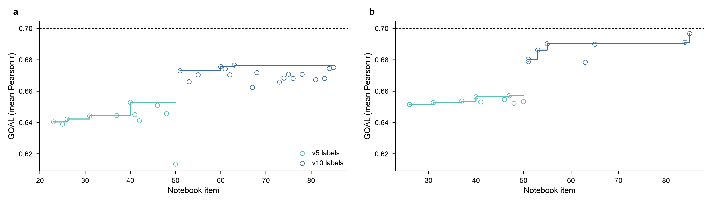

### Figure 2 · Matched single-network experiments

Heads, losses, label definitions, encoders and external data are compared against seed-matched ResNet controls.

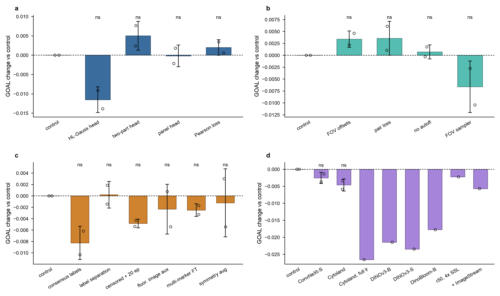

### Figure 3 · Where the remaining error sits

The weak markers, the smaller training draw, the step-matched learning curve and agreement between label estimators locate different sources of error.

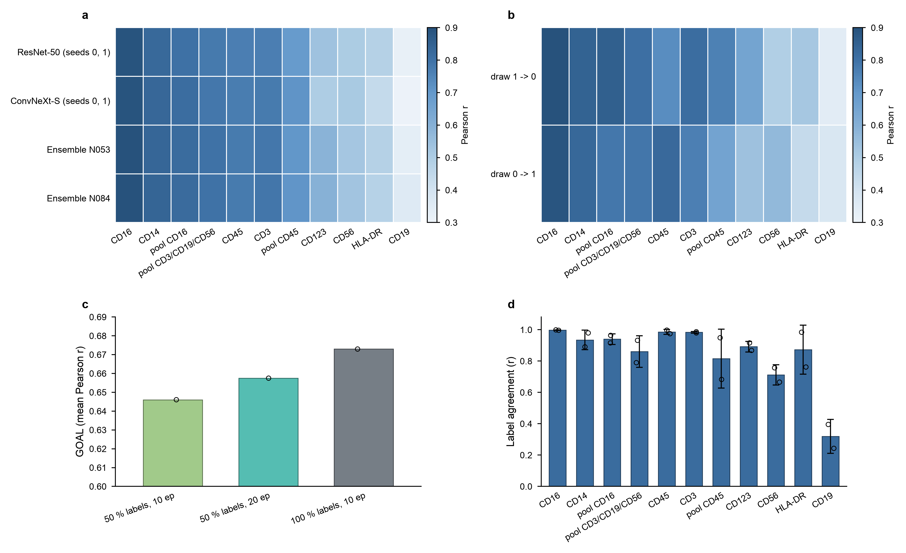

### Figure 4 · Joint decoding on two instruments

BSCCM tests pooled fluorescence. ImageStream reveals the effects of sparse supervision on all nine markers and their within-cell relationships.

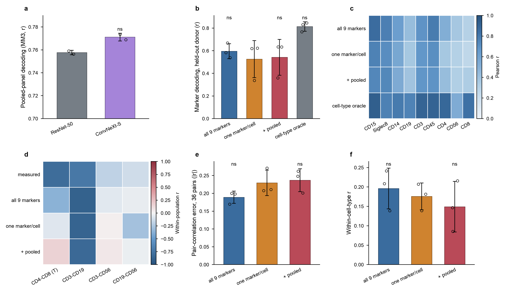

### Figure 5 · Teach a Giemsa reader through LF

Clinical AUROC and measured same-cell autofluorescence compare output distillation, latent distillation, class anchoring and two-space alignment.

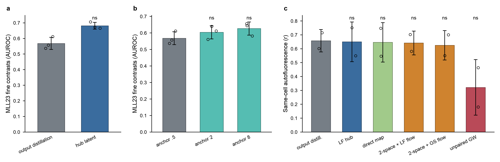

### Figure 6 · Follow a cell through the four-member ensemble

The input stack feeds four image encoders. Pooled features pass to sparse-supervision heads, and the marker predictions are averaged at inference.

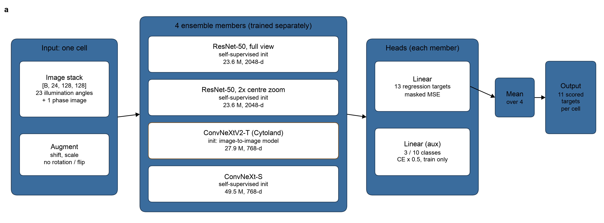

### Figure 7 · Compare encoders and build the ensemble

Strong standalone performance and complementary errors are different properties. The cf150 ResNet pair gained most from Cytoland as its third member.

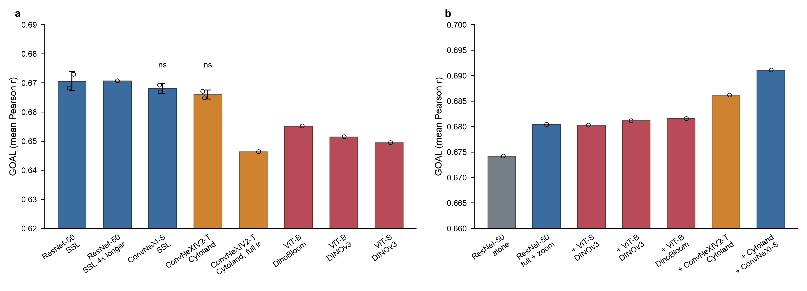

### Figure 8 · Align modalities across slides

On held-out slides, SigLIP ranked the paired LF cell in the top ten for .030 of queries. Within-slide R@10 of .38–.40 is genuine cell identity: the N092 control with different cells of the same field reaches only .02–.03. Distillation carries autofluorescence better across slides, and bag supervision weakens as same-cell sets grow.

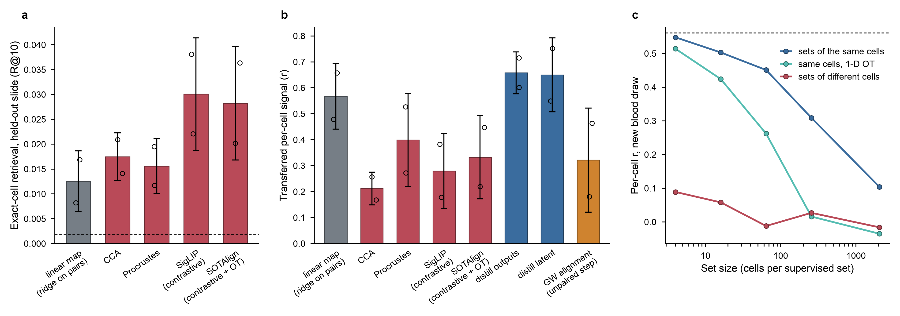

### Figure 9 · Transfer to a new smear dataset or draw

Clinical adaptation and test-draw normalization are compared with unadapted predictions, class anchoring and changes to the teacher target.

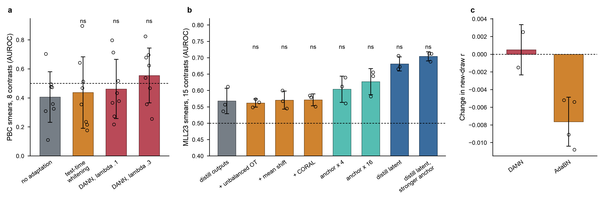

### Figure 10 · Decoders, autoencoders and marker priors

Bottleneck rank vs GOAL, frozen representations with an MLP decoder, cell-type clustering of held-out cells, and learned marker priors in the ImageStream sandbox (N087).

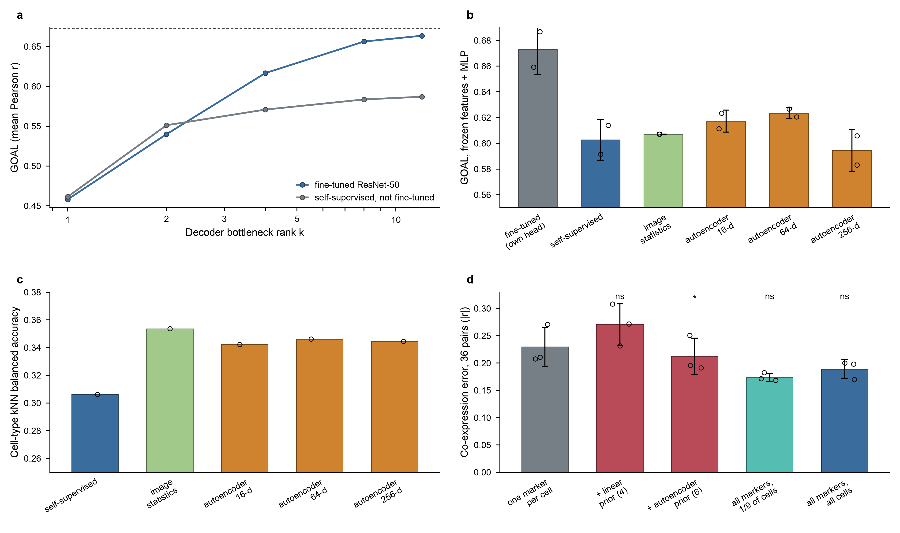

### Figure 11 · Cell lineages on BSCCM

Predicted marker profile of each true lineage, predicted CD3 vs CD19 on true T and B cells, lineage AUROCs and the predicted CD3–CD19 correlation for the record ensemble (N097).

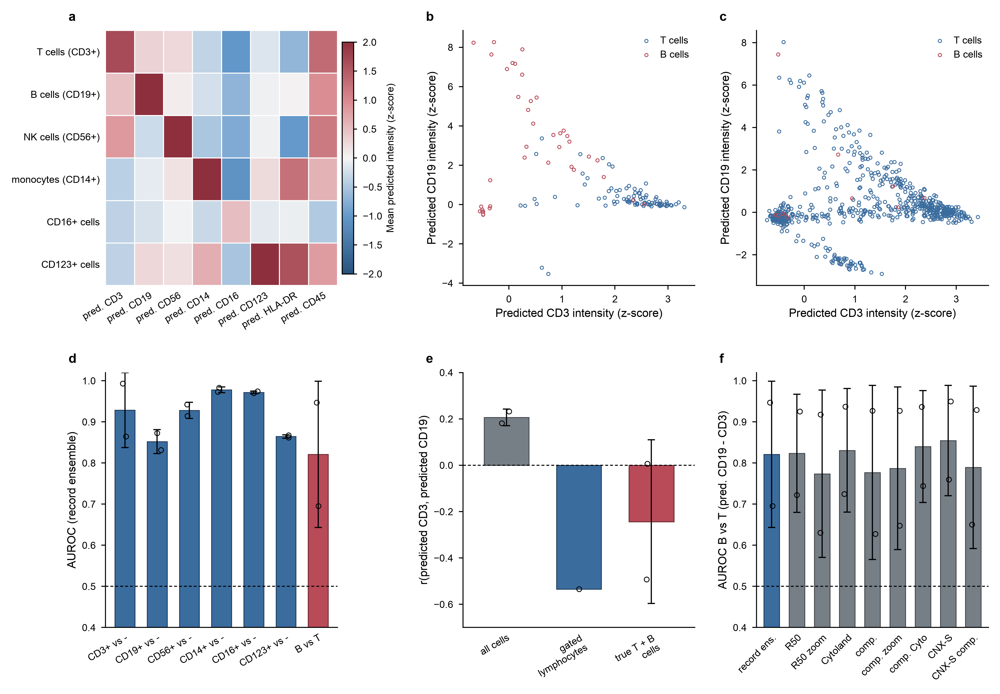

### Figure 12 · CD3–CD19 exclusivity where every marker is measured

ImageStream sandbox: measured vs predicted CD3/CD19 in lymphocytes, within-lymphocyte correlation, T-vs-B AUROC and per-type marker profiles (N097).

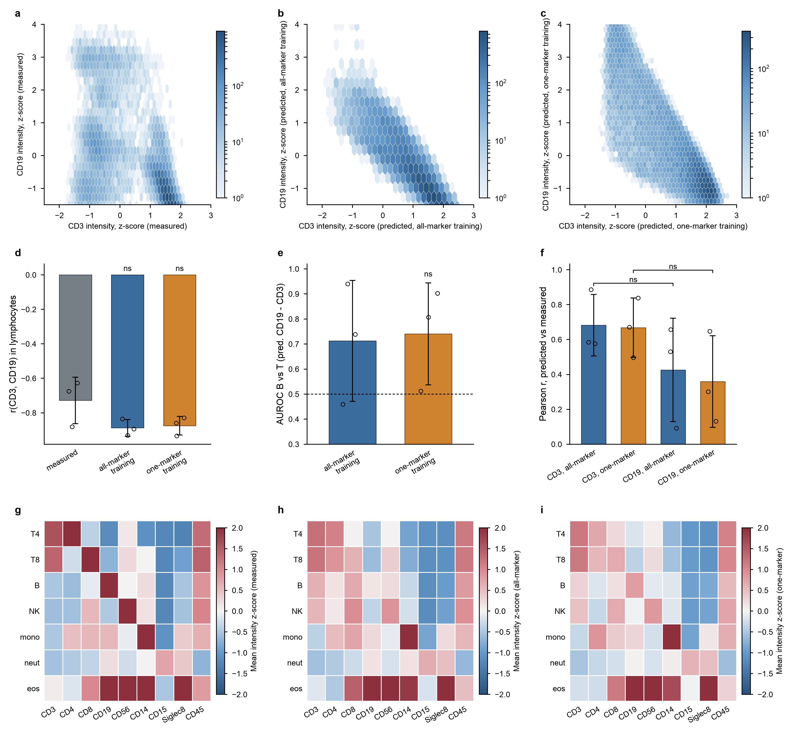

### Figure 13 · CD4 vs CD8 T cells (ImageStream sandbox only)

Measured vs predicted CD4/CD8 in T cells, within-T-cell correlation, CD4 T vs CD8 T AUROC and per-marker accuracy (N097). BSCCM has no CD4/CD8 stain.

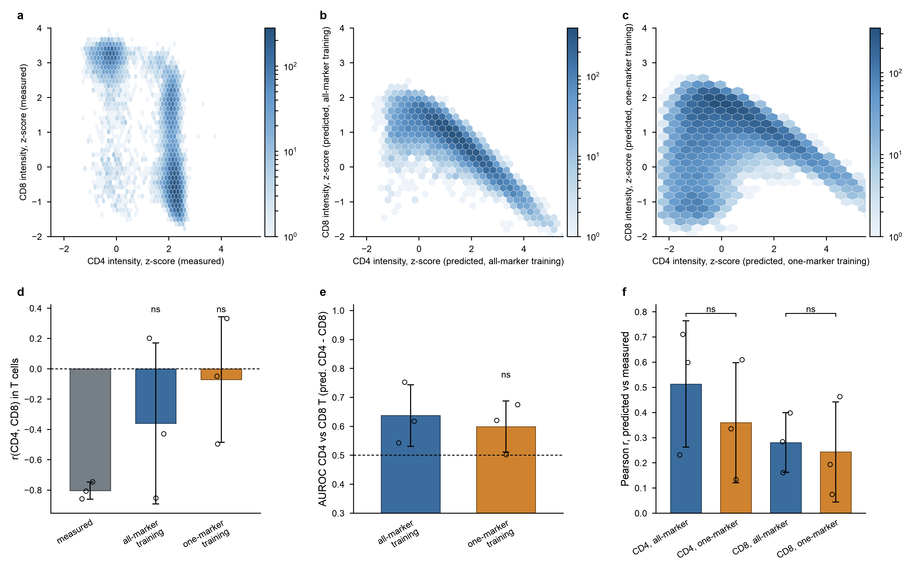

## Current work and open questions

**Can the ensemble clear .6916 on the frozen v10 protocol?** N085 combines 120-epoch source-only ConvNeXt-S pretraining on both draws with panel heads for pooled targets and two-part/FOV-offset heads for singles.
Its primary comparison is the pre-specified eight-member average. MM3, the six-member subset and standalone members are secondary. The primary comparison cleared the bar (.6967 > .6916); see the caveat in the summary. [N085] · [Registered scorer](.agent-research/results/N085-stronger-members-convnext-s-with-120-ep/n085_score.py)

**Can the decoder recover more from a fixed image?** N087 starts with the same ResNet features and compares the original head, ridge regression, reduced-rank readouts, a multilayer perceptron and nearest neighbours.
The original head reproduced .6730 in the completed flow comparison. The proposed nonlinear follow-up requires gains above .0054 in both directions. [N087]

**What survives compression?** The image autoencoder arm trains on the source draw with latent sizes 16, 64 and 256. Held-out performance is measured by GOAL, clustering agreement with gated classes, and nearest-neighbour balanced accuracy.
PCA-compressed SSL features provide a matched-dimension control. Other arms retain the pretrained SSL projector or add a narrow bottleneck during fine-tuning. [N087]

The marker-prior arm tests whether PCA or an autoencoder trained on a validation donor can reduce 36-pair error to .210 or less with at most .010 loss in mean marker r. [N087]

### What did the flow decoder recover?

On frozen ImageStream features, a single conditional flow sample nearly recovered the measured spread on average across markers. Its T-cell CD4–CD8 correlation remained far weaker than the measured **−.804**. Each sandbox column averages three held-out donors. The last column gives BSCCM GOAL over both draw directions. The ImageStream flow samples a joint nine-marker vector. The BSCCM flow conditions on the target identity and samples one marker at a time. [N087]

| Decoder | Sandbox mean per-marker r | Predicted CD4–CD8 r in T cells | Predicted / measured marker SD | BSCCM GOAL |
|---|---:|---:|---:|---:|
| Original linear head | .588 | −.36 | .74 | .6730 |
| MLP | .549 | −.27 | .82 | .6369 |
| Flow, mean of samples | .554 | −.22 | .815 | .6507 |
| Flow, one sample | .484 | −.31 | .97 | .5403 |

Flow did not restore co-expression on frozen features, the condition for taking the joint decoder into sparse-label training. On BSCCM, even the flow mean scored below the original head. The Codex red-team review found unequal decoder capacity in the sandbox and roughly twice as many optimizer updates per epoch for flow on BSCCM. The flow–MLP difference therefore cannot isolate the effect of the training objective. These results do not support pursuing frozen-feature flow decoding to improve GOAL. [N087]

**Can a class-conditional match help Giemsa cells?** N087 also proposes class means and within-class optimal transport from GS embeddings to marker profiles.
Teacher agreement, measured autofluorescence and clinical contrasts remain the available endpoints. Direct GS–marker accuracy still requires a paired reference. [N087] · [Pairing audit][N004]

### Which experiments follow from the literature review?

The three N088 reviews (104 references) prioritized preserving source-draw features during fine-tuning, checking whether measurements from the same cell help fill missing labels, and separating field recognition from cell recognition. The synthesis proposed the following portfolio. [N088]

1. **Gentle fine-tuning, launched in N090.** Test smaller encoder updates first. Next, train the readout before unfreezing the encoder (LP-FT) and evaluate interpolations of pretrained and fine-tuned encoder weights (WiSE-FT). [N090]
2. **Decoding and compression, N087.** Compare frozen readouts, image autoencoders and marker priors. The flow arm is complete. The equal-label-count control asks how much of the N080 full-label advantage comes from measuring more targets in total. [N087]
3. **Missing-marker completion.** Test on CPU whether a cell’s measured marker improves estimates of its missing markers in the jointly labelled sandbox before training a BSCCM model.
4. **Field-of-view audit.** Test whether within-slide LF–Giemsa retrieval identifies the field using shared focus or background. If it does, test alignment that controls for those cues.
5. **Nested projection.** Test a projection that retains marker information in progressively smaller feature vectors (Matryoshka) in the sandbox before applying it to BSCCM.
6. **Cell-type mixture head.** After the label-count control, test whether cell-type profiles learned from S-BIAD452 help interpret sparse and pooled observations.
7. **Diverse ensemble members.** Test DINO-style in-domain SSL and SSL that pairs similar cells across slides of the training draw.

Other open ideas include a zoomed ConvNeXt-S member, ImageStream pretraining with separate downstream heads, and bag-level learning on cohorts with varying cell composition. Acquiring marker and Wright images on the same cells would give the supervising lab a direct test of the GS bridge. [Open ideas](.agent-research/notebook/IDEAS.md)

[N001]: .agent-research/notebook/items/N001-bsccm-training-format-pack-fixed-record.md
[N002]: .agent-research/notebook/items/N002-literature-review-trimodal-alignment-wit.md
[N003]: .agent-research/notebook/items/N003-dataset-audit-modality-pairing-labels-sp.md
[N004]: .agent-research/notebook/items/N004-premise-finding-no-same-cell-giemsa-mark.md
[N005]: .agent-research/notebook/items/N005-data-curation-v2-per-batch-marker-normal.md
[N006]: .agent-research/notebook/items/N006-supervised-lf-mk-baseline-on-curated-tar.md
[N007]: .agent-research/notebook/items/N007-ssl-pretraining-of-the-lf-encoder-cross.md
[N008]: .agent-research/notebook/items/N008-external-lineage-anchor-pbc-acevedo-mgg.md
[N009]: .agent-research/notebook/items/N009-stage-2-binding-v0-on-frozen-sup-lf-feat.md
[N010]: .agent-research/notebook/items/N010-image-level-gs-encoder-dinobloom-b-last.md
[N011]: .agent-research/notebook/items/N011-diagnose-the-cross-slide-gs-failure-auto.md
[N012]: .agent-research/notebook/items/N012-skeptic-control-is-the-within-slide-gs-a.md
[N013]: .agent-research/notebook/items/N013-targets-v4-remove-slide-position-artefac.md
[N014]: .agent-research/notebook/items/N014-teacher-v4-portfolio-resnet50-x15-ep-ssl.md
[N015]: .agent-research/notebook/items/N015-gs-chain-with-the-ssl-init-r50-teacher-f.md
[N016]: .agent-research/notebook/items/N016-simulated-mosaic-with-ground-truth-pseud.md
[N017]: .agent-research/notebook/items/N017-real-gs-mk-error-estimate-without-gs-mk.md
[N018]: .agent-research/notebook/items/N018-lf-information-map-supervised-r18-per-le.md
[N019]: .agent-research/notebook/items/N019-final-gs-student-both-slides-fov-hold-ou.md
[N020]: .agent-research/notebook/items/N020-clinical-transfer-via-unsupervised-domai.md
[N021]: .agent-research/notebook/items/N021-class-anchored-alignment-to-pbc-anchors.md
[N022]: .agent-research/notebook/items/N022-fine-grained-teacher-rare-population-tai.md
[N023]: .agent-research/notebook/items/N023-label-qc-per-batch-dye-amplitude-single.md
[N024]: .agent-research/notebook/items/N024-v5-label-r18-supervised-teacher-for-the.md
[N025]: .agent-research/notebook/items/N025-giemsa-chain-without-the-trade-off-two-t.md
[N026]: .agent-research/notebook/items/N026-lf-teacher-resolution-test-time-batch-ad.md
[N027]: .agent-research/notebook/items/N027-giemsa-student-capacity-on-the-tt6-chain.md
[N028]: .agent-research/notebook/items/N028-virtual-wright-giemsa-staining-from-labe.md
[N029]: .agent-research/notebook/items/N029-clean-calibration-cohort-no-giemsa-hist.md
[N030]: .agent-research/notebook/items/N030-giemsa-student-with-fewer-trainable-bloc.md
[N031]: .agent-research/notebook/items/N031-inductive-ssl-control-re-pretrain-the-ss.md
[N032]: .agent-research/notebook/items/N032-teacher-run-variance-of-clinical-transfe.md
[N033]: .agent-research/notebook/items/N033-virtual-stain-data-engine-giemsa-student.md
[N034]: .agent-research/notebook/items/N034-lf-fluorescence-marker-images-by-conditi.md
[N035]: .agent-research/notebook/items/N035-frozen-confirmation-of-n034-a-in-the-unt.md
[N036]: .agent-research/notebook/items/N036-label-position-detrend-v7-cross-fit-the.md
[N037]: .agent-research/notebook/items/N037-goal-retrain-on-cross-fitted-labels-n031.md
[N038]: .agent-research/notebook/items/N038-review-lf-mk-common-11-batch-held-out-go.md
[N039]: .agent-research/notebook/items/N039-label-v8-re-derive-single-antibody-marke.md
[N040]: .agent-research/notebook/items/N040-dense-label-completion-noisy-student-lab.md
[N041]: .agent-research/notebook/items/N041-physics-based-source-only-nuisance-rando.md
[N042]: .agent-research/notebook/items/N042-weak-marker-architecture-low-pass-input.md
[N043]: .agent-research/notebook/items/N043-paper-figures-in-the-house-style-pfig-fi.md
[N044]: .agent-research/notebook/items/N044-residual-flow-matching-corrdiff-style-fo.md
[N045]: .agent-research/notebook/items/N045-sotalign-semi-supervised-ot-alignment-gi.md
[N046]: .agent-research/notebook/items/N046-noisy-student-round-2-teacher-n040-stude.md
[N047]: .agent-research/notebook/items/N047-review-2-lf-mk-goal-6527-target-67-after.md
[N048]: .agent-research/notebook/items/N048-label-v9-asinh-cofactor-from-a-pre-regis.md
[N049]: .agent-research/notebook/items/N049-noise-aware-positive-negative-marker-lab.md
[N050]: .agent-research/notebook/items/N050-heterogeneous-ensemble-member-different.md
[N051]: .agent-research/notebook/items/N051-label-v10-per-marker-asinh-cofactor-pre.md
[N052]: .agent-research/notebook/items/N052-tri-modal-latent-plan-user-two-space-pro.md
[N053]: .agent-research/notebook/items/N053-lf-encoder-swap-on-the-v10-goal-dinov3-v.md
[N054]: .agent-research/notebook/items/N054-tri-modal-latent-user-two-space-design-l.md
[N055]: .agent-research/notebook/items/N055-ensemble-diversification-with-microscopy.md
[N056]: .agent-research/notebook/items/N056-e3-clinical-transfer-class-anchored-giem.md
[N057]: .agent-research/notebook/items/N057-anchor-strength-sweep-for-the-tt6c-giems.md
[N058]: .agent-research/notebook/items/N058-confirm-hub-tt6c-on-mll23-fine-contrasts.md
[N059]: .agent-research/notebook/items/N059-review-3-lf-mk-v10-goal-6862-target-70-a.md
[N060]: .agent-research/notebook/items/N060-rare-positive-output-heads-for-dim-marke.md
[N061]: .agent-research/notebook/items/N061-within-fov-pairwise-difference-loss-shar.md
[N062]: .agent-research/notebook/items/N062-panel-matrix-latent-head-shared-molecula.md
[N063]: .agent-research/notebook/items/N063-composite-of-the-n060-n062-partial-wins.md
[N064]: .agent-research/notebook/items/N064-noise-ceiling-bracket-for-the-v10-goal-p.md
[N065]: .agent-research/notebook/items/N065-composite-recipe-ensemble-rebuild-every.md
[N066]: .agent-research/notebook/items/N066-review-4-lf-mk-v10-goal-6862-target-70-a.md
[N067]: .agent-research/notebook/items/N067-consensus-background-training-targets-tr.md
[N068]: .agent-research/notebook/items/N068-exact-symmetry-augmentation-anti-diagona.md
[N073]: .agent-research/notebook/items/N073-measurement-aware-supervision-censored-c.md
[N074]: .agent-research/notebook/items/N074-dense-privileged-supervision-auxiliary-d.md
[N075]: .agent-research/notebook/items/N075-label-separation-v10-head-auxiliary-head.md
[N076]: .agent-research/notebook/items/N076-multi-marker-final-fine-tune-continue-tr.md
[N077]: .agent-research/notebook/items/N077-external-data-scout-public-label-free-su.md
[N078]: .agent-research/notebook/items/N078-in-domain-ssl-scaling-sigreg-lf-pretrain.md
[N079]: .agent-research/notebook/items/N079-review-5-lf-mk-v10-goal-6862-target-70-a.md
[N080]: .agent-research/notebook/items/N080-joint-decoding-sandbox-on-s-biad452-all.md
[N081]: .agent-research/notebook/items/N081-two-stem-joint-source-training-bsccm-led.md
[N082]: .agent-research/notebook/items/N082-step-matched-learning-curve-50-training.md
[N083]: .agent-research/notebook/items/N083-convnext-s-in-domain-ssl-encoder-for-mul.md
[N084]: .agent-research/notebook/items/N084-pre-registered-ensemble-confirmation-n05.md
[N085]: .agent-research/notebook/items/N085-stronger-members-convnext-s-with-120-ep.md
[N086]: .agent-research/notebook/items/N086-project-overview-figures-progress-per-la.md
[N087]: .agent-research/notebook/INDEX.md?plain=1#L65
[N088]: .agent-research/notebook/INDEX.md?plain=1#L66
[N089]: .agent-research/notebook/INDEX.md?plain=1#L67
[N090]: .agent-research/notebook/INDEX.md?plain=1#L68
[N091]: .agent-research/notebook/INDEX.md?plain=1#L69
[N092]: .agent-research/notebook/INDEX.md?plain=1#L70
[N093]: .agent-research/notebook/INDEX.md?plain=1#L71
[N097]: .agent-research/notebook/INDEX.md?plain=1#L75
